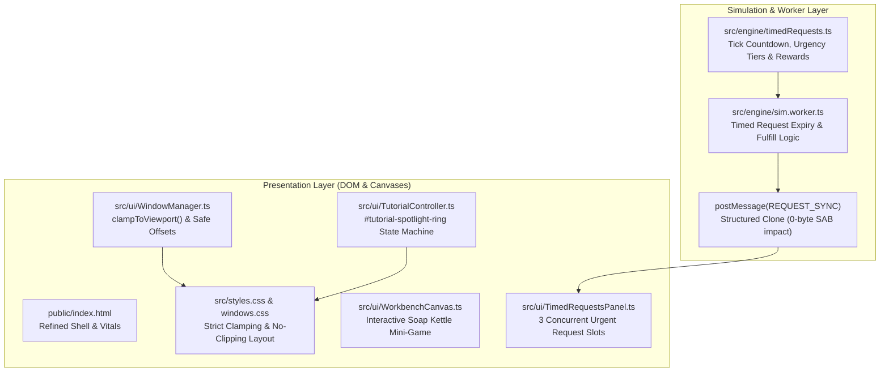

# G&L Auditor V2: Target Architecture & Areas Being Edited

**Document:** `docs/.scratch-audit/ARCHITECTURE.md`  
**Run:** `run-001`  
**Date:** 2026-11-04  

---

## 1. Architectural Changes Overview

---

## 2. Areas Being Edited

| File | Nature of Edit | Invariant Protection |
| :--- | :--- | :--- |
| `src/styles.css` | Box sizing, border clipping fixes, safe insets, spotlight overlay styling. | No external CSS, responsive down to 1280x720. |
| `src/ui/windows/windows.css` | Window dimensions, safe margin, responsive sheets. | WCAG 2.2 touch target compliance. |
| `src/ui/WindowManager.ts` | Add `clampToViewport` for floating & modal window bounds. | Non-breaking API. |
| `src/data/items.ts` | Add `simpleDesc` and enhance clarity while preserving all canonical item IDs. | Integrity check in `tests/items.test.ts` passes. |
| `src/ui/TutorialController.ts` | Dynamic element spotlight `#tutorial-spotlight-ring` tracking target bounding rect. | Backward compatible with existing curriculum. |
| `src/engine/timedRequests.ts` | Engine for 3 concurrent timed town requests (new module). | Pure TypeScript, zero npm deps. |
| `src/engine/sim.worker.ts` | Handle `FULFILL_REQUEST` and emit `REQUEST_SYNC` on tick loop. | `SAB_BYTE_LENGTH` unchanged at 67648 B. |
| `src/app/workerMessages.ts` | Dispatch `REQUEST_SYNC` and update UI state. | Strict type assertions. |
