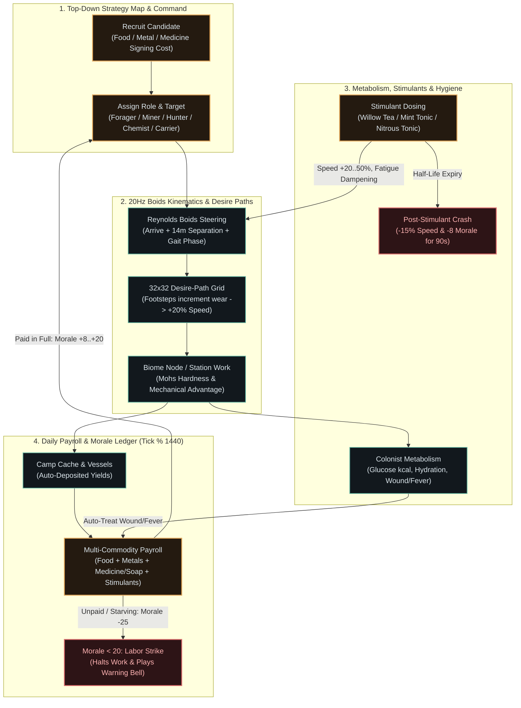

# Top-Down Strategy & Colony Labor System ("The Alchemist's Company") Implementation Plan (Enhanced)

> **Agent:** Execute this plan task-by-task using TDD, visual verification, and transform auditing (via `surgical-implementation` once approved).
> **Enhanced sub-skills invoked:** `surgical-investigation` (Mode 2: Project-Manager, Pass 2 4-Pillar Escalation), `writing-plans-enhanced`, `plastic-surgery` (WCAG 2.2 & diegetic UI invariants).
> **Verification mode:** Automated Vitest TDD + TypeScript strict typecheck + Webpack production budget gate (`< 200 KiB`) + DOM/Canvas transform verification.

**Goal:** Transform *How to Make Soap — The Grand Crucible* into a top-down 2D strategy and colony-labor simulation where the player recruits specialized human laborers, directs them across a diegetic 2D biome map with emergent desire paths and Craig Reynolds Boids steering, and compensates/sustains them with multi-commodity wages (**Food**, **Metals & Tools**, **Medicines & Soap**, and **Chemical Stimulants**).

**Architecture:** Preserve the zero-dependency TypeScript + Web Worker (`sim.worker.ts`) + `SharedArrayBuffer` (`SAB_BYTE_LENGTH = 67648`) architecture. Run deterministic 2D colonist kinematics, Boids separation, desire-path wear accumulation, metabolism/condition progression, stimulant pharmacokinetics, daily paddock husbandry, and multi-commodity wage payroll inside `sim.worker.ts` at 20 Hz, streaming a compact `COLONY_SYNC` payload to the main thread for 60 fps HTML5 Canvas rendering and spatial Web Audio synthesis.

**Anti-Gravity boundary:**
- `SAB_BYTE_LENGTH` in [src/engine/memoryLayout.ts](file:///home/leandi-duplessis/github/workspaces/How%20to%20make%20soap/src/engine/memoryLayout.ts#L60-L65) MUST remain `67648` (`tests/memoryLayout.test.ts` hard invariant).
- Zero runtime dependencies in `package.json`; Webpack entrypoint bundle MUST remain `< 200,000` bytes (`webpack.config.js:50` `performance.maxEntrypointSize`; currently `141 KiB`, leaving `59 KiB` headroom).
- Every item referenced in `BIOME_DAG` or `FABRICATION_RECIPES` (unless in `VESSEL_ONLY_IDS`) MUST exist in `ITEMS` ([src/data/items.ts](file:///home/leandi-duplessis/github/workspaces/How%20to%20make%20soap/src/data/items.ts#L29-L105)) with a valid `ICONS[item.icon]` (`stroke="currentColor"`, `viewBox="0 0 24 24"`), `tier` $\in [1, 5]$, and `desc.length >= 12` (`tests/items.test.ts`).
- `CHAPTERS` length (`6`) and `LETTERS` length (`18`) in [src/data/story.ts](file:///home/leandi-duplessis/github/workspaces/How%20to%20make%20soap/src/data/story.ts) MUST remain unchanged (`tests/story.test.ts`).

---

## 1. Pass 2 Escalation Revision Log (3-Subagent Triangulation Synthesis)

> [!IMPORTANT]
> Under the `/surgical-investigation` **4-Pillar Escalation Protocol**, three read-only research subagents audited the codebase in parallel (`Engine & Data Capability Auditor` [92d014ae](conversation://92d014ae-d8bd-49aa-b6e9-7347ce8ff0ff), `UI, WCAG 2.2 & Audio Auditor` [432bb151](conversation://432bb151-9cb0-49c0-bc51-a825dd4b033f), and `Test Invariants & Build Auditor` [032acb31](conversation://032acb31-8bc8-4ffe-bc03-67a5f4d79736)). Pass 2 uncovered **7 pre-existing runtime defects** and **5 accessibility/UI contract gaps** that Pass 1 missed, and elevated the plan with **5 Artistic Engineering architecture pillars**.

| Pass 1 Assumption | Pass 2 Triangulated Finding (`{file_or_url, tier, confidence}`) | Action in Pass 2 Plan |
| :--- | :--- | :--- |
| Assumed manual `HARVEST_PART` in `src/main.ts` worked as a template for colonist harvesting. | **Confirmed Defect (Tier 1, High):** [src/main.ts](file:///home/leandi-duplessis/github/workspaces/How%20to%20make%20soap/src/main.ts#L735-L742) sends `{ type: 'HARVEST_PART', partId: part.id }`, omitting `speciesId`, `carriedMassKg`, `toolSlot`, and `distanceMeters` required by [src/engine/sim.worker.ts](file:///home/leandi-duplessis/github/workspaces/How%20to%20make%20soap/src/engine/sim.worker.ts#L69). `speciesNode` evaluates to `undefined` at `sim.worker.ts:314`, failing every manual harvest click with `Unknown part`. | **Added Task 0:** Fix `HARVEST_PART` in `src/main.ts` and `BiomeTreePanel.ts` (passing `species.id` and `species.baseDistanceMeters`), and re-render haul kcal when tools change. |
| Assumed `EQUIP_TOOL` in `sim.worker.ts` supported equipping crafted tools. | **Confirmed Defect (Tier 1, High):** [src/main.ts](file:///home/leandi-duplessis/github/workspaces/How%20to%20make%20soap/src/main.ts#L574) sends `{ type: 'EQUIP_TOOL', itemId, slot }`, while [src/engine/sim.worker.ts](file:///home/leandi-duplessis/github/workspaces/How%20to%20make%20soap/src/engine/sim.worker.ts#L408-L410) reads `command.toolId` and only checks `METALLURGY_TOOLS` (omitting Tier-1 `FLINT_FLAKE_BLADE`, `FLINT_ADZE`, `BONE_AWL`, `RIVER_HAMMERSTONE`, `WOODEN_TONGS`). Also `sim.worker.ts:419` wipes stacks $>1$ (`slots[i] = null`) and omits `campCache`. | **Added Task 0:** Accept `itemId ?? toolId`, resolve all tool items via `ITEM_BY_ID` + `METALLURGY_TOOLS`, decrement stack count safely, include `campCache`, and allow replacing equipped tools in `ToolAndInventoryPanel.ts:52`. |
| Assumed `EAT_FOOD` and `APPLY_TREATMENT` worked across all inventory containers and medicine items. | **Confirmed Defect (Tier 1, High):** [src/engine/sim.worker.ts](file:///home/leandi-duplessis/github/workspaces/How%20to%20make%20soap/src/engine/sim.worker.ts#L447-L515) omits `inventory.campCache` in `EAT_FOOD` and `APPLY_TREATMENT` (so `14 kg` `MEAT_RAW` in `campCache` cannot be eaten!), `APPLY_TREATMENT` heals before checking item ownership, and [src/ui/panelModels.ts](file:///home/leandi-duplessis/github/workspaces/How%20to%20make%20soap/src/ui/panelModels.ts#L43) keys `'SALICYLIC_TINCTURE'` instead of `'SALICYLIC_ACID_TINCTURE'`. | **Added Task 0:** Include `campCache` in `EAT_FOOD` & `APPLY_TREATMENT`, verify item ownership before applying treatment, break outer loop after consuming 1 unit, and support both `'SALICYLIC_ACID_TINCTURE'` and `'SALICYLIC_TINCTURE'` in `panelModels.ts`. |
| Assumed `Paddock` tab was connected to the simulation worker. | **Confirmed Defect (Tier 1, High):** [src/main.ts](file:///home/leandi-duplessis/github/workspaces/How%20to%20make%20soap/src/main.ts#L516-L533) mutates local `state.paddock` without messaging `sim.worker.ts`, and [src/engine/sim.worker.ts](file:///home/leandi-duplessis/github/workspaces/How%20to%20make%20soap/src/engine/sim.worker.ts#L110-L112) has an empty comment stub that never calls `stepPaddockDay`. | **Added Task 0:** Wire `FEED_PADDOCK`, `WATER_PADDOCK`, and daily `stepPaddockDay` in `sim.worker.ts`, allowing Herder/Chemist colonists to tend livestock automatically. |
| Assumed soap existed as an inventory item for hygiene/morale wages. | **Confirmed Gap (Tier 1, High):** `NA_STEARATE` and `K_STEARATE` exist only as vessel species (`VESSEL_ONLY_IDS` in `tests/items.test.ts:13-22`); there is no carryable `BAR_SOAP` in `ITEMS`. | **Updated Task 1:** Add `BAR_SOAP` (`category: 'medicine'`, `affinity: 'soapwright'`) and 3 chemical stimulants (`WILLOW_TEA`, `MINT_TONIC`, `NITROUS_TONIC`) to `ITEMS` and `FABRICATION_RECIPES` (`MOLD_BAR_SOAP` consuming vessel `SOAP_PASTE` via `VESSEL_INPUTS`). |
| Pass 1 used simple linear point-to-point movement and static canvas rings. | **Artistic Engineering Upgrade:** Linear movement causes multiple workers at the same node to stack on a single pixel and lacks visual history or atmosphere. | **Updated Tasks 2, 4, 5:** Added **Craig Reynolds Boids Steering** (`arrive` + `separation` + gait bobbing), **Emergent Desire Paths** (`Uint8Array(1024)` 32×32 wear grid that renders worn footpaths and grants up to `+20%` trail speed), **Diurnal 24h Lighting & Hearth Glow**, and **Stereo-Panned Web Audio Strategy Cues**. |
| Pass 1 did not address existing WCAG 2.2 regressions in `styles.css` and `StoryMode.ts`. | **Confirmed Defect (Tier 1, High):** `.story-overlay` lacks `position: fixed; inset: 0; z-index` in `styles.css`, `.banner-${b.severity}` mismatches `.banner-wound`/`.banner-fever`, `#hud-renown` never updates `aria-valuenow`, and small buttons violate WCAG 2.2 SC 2.5.8 (`24×24 CSS px`). | **Updated Task 5:** Fix `.story-overlay`, banner classes, `#hud-renown` `aria-valuenow`, WCAG 2.2 SC 2.5.8 target sizes, SC 2.4.11 modal focus management, SC 2.4.13 dual-ring focus appearance, and `@media (prefers-contrast: more)` / `@media (forced-colors: active)`. |

---

## 2. System Architecture & Data-Flow Diagrams (Mermaid 11.1+)

### 2.1 Thread, Memory & Rendering Topology (`architecture-beta`)

### 2.2 Multi-Commodity Labor, Pharmacokinetics & Desire-Path Loop (`flowchart TB`)

---

## 3. Artistic Engineering & Feature Recommendations Matrix

Per `references/feature-recommendation-format.md`, each subsystem is specified with concrete commands, payloads, events, visual widgets, acceptance criteria, measurable metrics, and ADR stubs.

### Feature 1: Diegetic Alchemical Cartography, Diurnal Lighting & Desire Paths
- **What:** A top-down 2D HTML5 Canvas strategy viewport (`StrategyMapCanvas.ts`) styled as an engraved alchemist's slate-and-parchment field survey with concentric brass astrolabe range rings (`20m` Camp Perimeter, `75m` Timber/Forage Belt, `150m` Quarry/Hunting Frontier, `250m` Outer Wilds), dynamic 24-hour diurnal lighting with a warm radial campfire hearth glow at `(0, 0)`, and a `32×32` (`Uint8Array(1024)`) **Desire Path** wear grid.
- **Why:** Transforms an abstract list of biome distances into a living spatial territory where the player visually reads colony logistics: heavily traveled routes between the Camp Hearth and key deposits (e.g., Malachite or White Oak) organically wear golden-ochre footpaths into the terrain and accelerate hauling by up to `+20%`.
- **How (technical):**
  - Extend `SpeciesNode` in [src/data/biomeNodes.ts](file:///home/leandi-duplessis/github/workspaces/How%20to%20make%20soap/src/data/biomeNodes.ts#L19-L26) with `readonly mapAngleRad: number` so each species has deterministic polar & Cartesian coordinates $(x = r\cos\theta, y = r\sin\theta)$ matching its exact `baseDistanceMeters`.
  - Maintain `desirePathGrid: Uint8Array` (`32×32`, mapping world $[-260\text{m}, +260\text{m}]^2$) in [src/engine/colony.ts](file:///home/leandi-duplessis/github/workspaces/How%20to%20make%20soap/src/engine/colony.ts). Every 1 second of colonist movement increments the traversed cell by `+2` (capped at `255`), while natural overgrowth decays all cells by `-1` every 60 sim seconds.
  - Local trail speed multiplier: $M_{\text{trail}}(x,y) = 1.0 + 0.20 \times (\text{grid}[cell] / 255)$.
- **Interactive/control:** Pan (pointer drag / `WASD` / Arrow keys), zoom (wheel / `+` / `-`), click-to-select colonists or biome nodes, right-click or click `"Assign Selected"` to dispatch a colonist to any node, plus keyboard cycling (`[` / `]` to cycle colonists, `Space` to center on selection).
- **Worker Command:** `{ type: 'ASSIGN_COLONIST'; colonistId: string; role: ColonistRole; targetNodeId: string | null }`
- **Event:** `{ type: 'COLONY_SYNC'; colony: ColonySerializedState }`
- **Widget/visual:** Center workbench tab `🗺️ Strategy & Labor` hosting `<canvas id="strategy-map-canvas" tabindex="0" role="application" aria-label="Alchemical Colony Strategy Map">` with floating node inspector overlay and diurnal clock/hearth indicator.
- **Acceptance Criteria:**
  1. All 10 `BIOME_DAG` species render at their exact `baseDistanceMeters` radius and `mapAngleRad` angle.
  2. Walking between `(0,0)` and a node increments `desirePathGrid` cells along the trajectory and increases colonist transit speed up to `+20%`.
  3. Nighttime ticks (`hour < 6 || hour >= 20`) darken the ambient canvas overlay while rendering warm radial campfire and torch light halos around `(0,0)` and moving colonists.
- **Measurable Success Metric:** 60 fps canvas frame time `< 2.5 ms` for 12 colonists + 10 nodes + 1,024 desire-path cells; deterministic desire-path cell value $\ge 10$ after 1 round-trip in unit tests.
- **Effort:** Medium.

### Feature 2: Craig Reynolds Boids Steering & Colonist Autonomous State Machine
- **What:** Autonomous 2D colonist agents (`FORAGER`, `MINER`, `HUNTER`, `CHEMIST`, `CARRIER`, `IDLE`) governed by a 6-state finite state machine (`IDLE`, `WALKING_TO_NODE`, `HARVESTING`, `HAULING_BACK`, `TENDING_CAMP`, `RESTING` / `STRIKING`) and **Craig Reynolds Boids Steering** (`arrive` + short-range `separation` + sinusoidal gait phase bobbing).
- **Why:** Prevents multiple workers assigned to the same quarry or timber node from stacking on a single pixel, giving the colony tactile physical presence and readable crowd dynamics.
- **How (technical):**
  - Each `Colonist` tracks `(x, y)`, `(vx, vy)`, `gaitPhaseRad`, `role`, `targetNodeId`, `taskState`, `workProgressJ`, `carriedItem`, `equippedTool`, `glucoseKcal`, `hydrationPct`, `morale`, `fatiguePct`, `conditions`, `activeStimulant`, and ` wagePolicy`.
  - During `WALKING_TO_NODE` and `HAULING_BACK`, compute desired velocity toward target with arrival damping inside $R_{\text{arrive}} = 8\text{ m}$, plus pairwise repulsion $\vec{F}_{\text{sep}} = \sum_{j \neq i, d_{ij} < 14\text{m}} \frac{\vec{p}_i - \vec{p}_j}{d_{ij}^2}$ so workers fan out in a natural arc around the deposit or campfire.
  - Work rate scales with equipped tool hardness (`calculateMohsWorkMultiplier(toolMohs, part.targetMohs)`) and mechanical advantage, multiplied by trait, morale, and stimulant modifiers.
- **Interactive/control:** Colonist Roster Cards with role selector dropdown, target node selector, quick-equip tool button, and instant dose / feed / pay buttons.
- **Worker Commands:**
  - `{ type: 'RECRUIT_COLONIST'; candidateId: string; payResourceId: string }`
  - `{ type: 'ASSIGN_COLONIST'; colonistId: string; role: ColonistRole; targetNodeId: string | null }`
  - `{ type: 'EQUIP_COLONIST_TOOL'; colonistId: string; itemId: string }`
- **Event:** `EVENTS` log entries on recruitment, haul delivery, livestock tending, and tool wear; `OBJECTIVE` event `{ kind: 'recruit', target: role }`.
- **Widget/visual:** Animated 2D colonist tokens with role-colored cloaks, directional velocity chevron, carried-cargo badge, stimulant aura ring, and floating status pip (`⚡` stimulated, `🩹` wounded, `✊` striking).
- **Acceptance Criteria:**
  1. Two colonists assigned to the same `BIOME_DAG` node never occupy identical coordinates ($d_{ij} \ge 3.5\text{ m}$ at rest around the node).
  2. Completing a harvest trip deposits the harvested item directly into `campCache` (or `backpack` overflow) and logs the haul.
  3. `CHEMIST` / `CARRIER` colonists assigned to Camp (`targetNodeId: 'CAMP_WORKBENCH'`) automatically stoke active vessel heaters (`+15%` reaction rate bonus) and tend Paddock livestock (`stepPaddockDay`).
- **Measurable Success Metric:** 100% deterministic trajectory under seeded `XorShift32` RNG; separation distance $\ge 3.5\text{ m}$ verified in `tests/colony.test.ts`.
- **Effort:** Medium.

### Feature 3: Multi-Commodity Wage Ledger, Bar Soap Hygiene & Stimulant Pharmacokinetics
- **What:** A colony economy where human recruits are hired and paid daily (`tick % 1440 === 0`) across **5 commodity tiers** (`FOOD`, `METALS`, `MEDICINES`, `STIMULANTS`, `SOAP_HYGIENE`), plus on-demand or auto-dosed **Chemical Stimulants** (`WILLOW_TEA`, `MINT_TONIC`, `NITROUS_TONIC`) with two-phase pharmacokinetics (boost phase $\rightarrow$ crash window) and **Molded Bar Soap** (`BAR_SOAP`) that prevents wound contamination and boosts colony morale.
- **Why:** Directly fulfills the user's core vision (*"paying them in different resources, metals, medicines, food, stimulants, etc."*) while tying every branch of the existing chemistry/fabrication tree (`apothecary`, `soapwright`, `forgewright`) into the strategy loop.
- **How (technical):**
  - New items in [src/data/items.ts](file:///home/leandi-duplessis/github/workspaces/How%20to%20make%20soap/src/data/items.ts):
    1. `BAR_SOAP` (`Molded Tallow Bar Soap`, `category: 'medicine'`, `tier: 2`, `affinity: 'soapwright'`, `icon: 'soapstone'`): Crafted via `MOLD_BAR_SOAP` from `1× SOAP_PASTE` (vessel input) + `1× SOAPSTONE_MOLD` (reusable/consumed mold). Grants `+14` morale and halves wound infection probability for 1 day.
    2. `WILLOW_TEA` (`Brewed Willow Analgesic Tea`, `category: 'medicine'`, `tier: 2`, `affinity: 'apothecary'`, `icon: 'willow'`): `+20%` work speed, `-30%` fatigue accumulation for `180s`, mild crash (`-5%` speed for `45s`).
    3. `MINT_TONIC` (`Distilled Menthol Hauler's Tonic`, `category: 'medicine'`, `tier: 3`, `affinity: 'apothecary'`, `icon: 'vial'`): `+35%` movement & work speed, `-40%` fatigue for `240s`, moderate crash (`-15%` speed, `-6` morale for `60s`).
    4. `NITROUS_TONIC` (`Laughing Gas Ether Draught`, `category: 'medicine'`, `tier: 4`, `affinity: 'apothecary'`, `icon: 'flask'`): `+55%` work speed, ignores pain/fatigue for `180s`, heavy crash (`-25%` speed, `-12` morale for `90s`).
  - Daily Payroll (`processDailyPayroll` at `tick % 1440 === 0`):
    - Deducts configured rations/wages from `campCache` / `backpack` / `bareHands`:
      - **Food Wage:** `MEAT_COOKED` (`+10` morale, `+950 kcal`), `BERRIES_RASP` (`+5` morale, `+220 kcal`), `MEAT_RAW` (`+2` morale, `+600 kcal`).
      - **Metal/Tool Stipend:** `COPPER_INGOT` (`+15` morale), `TIN_INGOT` (`+15` morale), `ZINC_INGOT` (`+18` morale), `SODIUM_METAL` (`+25` morale).
      - **Medicine & Hygiene Stipend:** `BAR_SOAP` (`+14` morale, clears dirty state), `SALINE_RINSE` / `ETHANOL_DISINFECTANT` (auto-clears `woundContamination`), `SALICYLIC_ACID_TINCTURE` (auto-clears `fever`), `PENICILLIN_DOSE` (auto-clears `systemicInfection`).
      - **Stimulant Ration:** `WILLOW_TEA`, `MINT_TONIC`, `NITROUS_TONIC` (`+12` morale + triggers boost phase).
    - Unpaid wages drop morale by `-25`; when `morale < 20`, the colonist enters `STRIKING` until paid manually via `PAY_COLONIST_BONUS` or the next daily payroll.
- **Worker Commands:**
  - `{ type: 'SET_WAGE_POLICY'; policy: Partial<ColonyWagePolicy> }`
  - `{ type: 'ADMINISTER_COLONIST_ITEM'; colonistId: string; itemId: string }`
  - `{ type: 'PAY_COLONIST_BONUS'; colonistId: string; itemId: string }`
- **Event:** `EVENTS` payroll summary + `audio.wageClink()` / `audio.stimulantShimmer()` / `audio.strikeBell()`.
- **Widget/visual:** Colony Wage Policy Bar (toggles for Food, Metals, Medicine/Soap, Stimulants + live daily burn rate preview) and per-colonist Morale & Stimulant Half-Life Meter.
- **Acceptance Criteria:**
  1. Crafting `MOLD_BAR_SOAP`, `BREW_WILLOW_TEA`, `DISTILL_MINT_TONIC`, and `SYNTHESIZE_NITROUS_TONIC` works end-to-end through `FABRICATE`.
  2. Administering a stimulant enters the boost phase and transitions into the recovery crash phase upon timer expiry.
  3. Daily payroll consumes enabled commodities from camp storage, updates colonist morale, and triggers `STRIKING` when unpaid and morale $< 20$.
- **Measurable Success Metric:** 100% unit test coverage of boost/crash transitions and payroll deductions in `tests/colony.test.ts`.
- **Effort:** Medium.

### Feature 4: Spatial Stereo Web Audio & WCAG 2.2 AA/AAA Strategy Accessibility
- **What:** Upgrade [src/ui/audio.ts](file:///home/leandi-duplessis/github/workspaces/How%20to%20make%20soap/src/ui/audio.ts) with a shared white-noise buffer, `StereoPannerNode` spatial positioning ($x \in [-250, +250]\text{ m} \mapsto \text{pan} \in [-0.85, +0.85]$), and 4 procedural strategy sound effects (`recruitHorn`, `wageClink`, `stimulantShimmer`, `strikeBell`), while fixing all WCAG 2.2 gaps audited in Pass 2.
- **Why:** Gives eyes-free spatial awareness of where colonists are harvesting or striking on the map, and ensures full keyboard and high-contrast accessibility.
- **How (technical):**
  - Add `pan` parameter (`-1` to `+1`) to `tone()` and `noise()` in `src/ui/audio.ts` via `ctx.createStereoPanner()`.
  - Fix WCAG 2.2 SC 2.5.8 target sizes (`min-height: 24px; min-width: 24px`), SC 2.4.11 focus management (`StoryMode` `.story-overlay` fixed positioning + modal focus return), SC 2.4.13 dual-ring `:focus-visible`, and `@media (prefers-contrast: more)` / `@media (forced-colors: active)` in [src/styles.css](file:///home/leandi-duplessis/github/workspaces/How%20to%20make%20soap/src/styles.css).
- **Acceptance Criteria:**
  1. All interactive buttons/inputs meet $\ge 24\times 24\text{ CSS px}$ target size.
  2. Strategy map supports full keyboard navigation (`Tab`, Arrow keys / `WASD`, `[` / `]`, `Enter`, `+` / `-`).
  3. `audio.recruitHorn()`, `audio.wageClink()`, `audio.stimulantShimmer()`, and `audio.strikeBell()` synthesize zero-asset audio with optional stereo pan.
- **Measurable Success Metric:** Zero exceptions in headless and browser environments; verified CSS rules for `SC 2.5.8`, `SC 2.4.11`, `SC 2.4.13`, `prefers-contrast: more`, and `forced-colors: active`.
- **Effort:** Low–Medium.

---

## 4. Architecture Decision Record (ADR) Stubs

### ADR-001: Keep `SAB_BYTE_LENGTH = 67648` Unchanged and Stream Colony State via `COLONY_SYNC`
- **Status:** Accepted
- **Context:** `tests/memoryLayout.test.ts:10` asserts `expect(SAB_BYTE_LENGTH).toBe(67648)`. Expanding the `SharedArrayBuffer` layout would break existing memory layout contracts.
- **Decision:** Keep `SharedArrayBuffer` strictly for high-frequency vessel/chemistry floats and telemetry, and broadcast colony state at 4 Hz (plus immediately on command mutations) via structured clone `{ type: 'COLONY_SYNC', colony }` alongside `PLAYER_SYNC`.
- **Consequences:** Zero regression risk to `memoryLayout.test.ts`; `< 1.5 KB` serialized payload per sync.

### ADR-002: Emergent Desire Paths via `Uint8Array(1024)` Wear Grid
- **Status:** Accepted
- **Context:** Strategy games benefit from visible logistical history ("Artistic Engineering": form follows simulation truth).
- **Decision:** Represent terrain wear as a compact `32×32` `Uint8Array(1024)` covering $[-260\text{m}, +260\text{m}]^2$. Colonist footsteps increment cell wear; natural flora regrowth slowly decays unused trails. Canvas renders cells with wear $> 4$ as warm ochre dashed/blended trail segments and grants up to `+20%` movement speed.
- **Consequences:** Adds only `1,024` bytes to memory and compresses trivially in Gzip Base64 saves.

### ADR-003: Craig Reynolds Boids Separation for Multi-Worker Nodes
- **Status:** Accepted
- **Context:** Multiple workers assigned to the same node would otherwise overlap at identical $(x,y)$ coordinates.
- **Decision:** Combine arrival steering toward target coordinates with short-range ($14\text{ m}$) inverse-square separation between colonists and a per-colonist sinusoidal gait phase.
- **Consequences:** Workers organically form arcs around resource nodes and march in staggered formations along trails.

---

## 5. Bite-Sized TDD Implementation Tasks

### Task 0: Fix Pre-Existing Runtime Defects Uncovered in Pass 2 Triangulation

**Files:**
- Modify: [src/engine/sim.worker.ts](file:///home/leandi-duplessis/github/workspaces/How%20to%20make%20soap/src/engine/sim.worker.ts)
- Modify: [src/ui/BiomeTreePanel.ts](file:///home/leandi-duplessis/github/workspaces/How%20to%20make%20soap/src/ui/BiomeTreePanel.ts)
- Modify: [src/ui/ToolAndInventoryPanel.ts](file:///home/leandi-duplessis/github/workspaces/How%20to%20make%20soap/src/ui/ToolAndInventoryPanel.ts)
- Modify: [src/ui/panelModels.ts](file:///home/leandi-duplessis/github/workspaces/How%20to%20make%20soap/src/ui/panelModels.ts)
- Modify: [src/main.ts](file:///home/leandi-duplessis/github/workspaces/How%20to%20make%20soap/src/main.ts)
- Create: `tests/workerCommandsBugfix.test.ts`

- [ ] **Step 1: Write failing regression tests in `tests/workerCommandsBugfix.test.ts`**
  Test:
  1. `treatmentModel` in `src/ui/panelModels.ts` recognizes `'SALICYLIC_ACID_TINCTURE'` (the actual item ID in `items.ts` and `fabrication.ts`) when `player.conditions.fever` is true.
  2. Equipping any tool from `ITEMS` with `toolSlot` (including Tier-1 `FLINT_FLAKE_BLADE`, `FLINT_ADZE`, `BONE_AWL`, `RIVER_HAMMERSTONE`, `WOODEN_TONGS`) resolves its `ToolItem` definition via a new helper `resolveToolItem(itemId)` in `src/engine/fabrication.ts`, decrements stack count by 1 (without wiping stacks $>1$), and checks `bareHands`, `backpack`, and `campCache`.
  3. `BiomeTreePanel` passes `(part, species)` to `onHarvest` so `HARVEST_PART` includes `speciesId`, `distanceMeters`, `toolSlot`, and `carriedMassKg`.
  4. `FEED_PADDOCK` and `WATER_PADDOCK` worker commands update worker `paddock` state and `stepPaddockDay` runs on day rollover (`tick % 1440 === 0`).

- [ ] **Step 2: Run Vitest to confirm failure**
  Run: `npx vitest run tests/workerCommandsBugfix.test.ts`

- [ ] **Step 3: Implement the fixes across `fabrication.ts`, `panelModels.ts`, `BiomeTreePanel.ts`, `ToolAndInventoryPanel.ts`, `sim.worker.ts`, and `main.ts`**
  - In `src/engine/fabrication.ts`, export `resolveToolItem(itemId: string): ToolItem | null` that checks `METALLURGY_TOOLS[itemId]` first and falls back to `ITEM_BY_ID[itemId]` if `item.toolSlot` is defined (mapping `mechanicalAdvantage: item.tier >= 2 ? 2.0 : 1.4`).
  - In `src/ui/panelModels.ts`, add `SALICYLIC_ACID_TINCTURE` alongside `SALICYLIC_TINCTURE` in `TREATMENTS`.
  - In `src/engine/sim.worker.ts`:
    - Update `EQUIP_TOOL` to accept `toolId?: string; itemId?: string`, use `resolveToolItem(id)`, search `[inventory.bareHands, inventory.backpack, inventory.campCache]`, decrement `s.count--` (only setting `null` when `s.count <= 0`), and return any previously equipped tool to `bareHands`, `backpack`, or `campCache`.
    - Update `EAT_FOOD` and `APPLY_TREATMENT` to search `[inventory.bareHands, inventory.backpack, inventory.campCache]`, and in `APPLY_TREATMENT` verify the item exists in inventory *before* mutating `player.conditions`, breaking out of both loops after consuming 1 unit.
    - Add `{ type: 'FEED_PADDOCK'; massKg: number }` and `{ type: 'WATER_PADDOCK'; liters: number }` to `Command`, step `stepPaddockDay(paddock)` every `1440` ticks (emitting milk/egg/manure events and adding harvested dairy/eggs to `campCache`), and include `paddock` in `PLAYER_SYNC`.
  - In `src/ui/BiomeTreePanel.ts` and `src/main.ts`: pass `(part, species)` to `onHarvest` and send full `{ type: 'HARVEST_PART', partId: part.id, speciesId: species.id, carriedMassKg: 0, toolSlot: part.preferredTool, distanceMeters: species.baseDistanceMeters }` to the worker. Allow `.btn-equip` in `ToolAndInventoryPanel.ts` even when a slot already has a tool (replacing it).

- [ ] **Step 4: Run full test suite**
  Run: `npx vitest run`

### Verify Visual & Transform Claims (Task 0)
- **Visual claim:** Fever banner displays "Administer Salicylic Tincture" button when `SALICYLIC_ACID_TINCTURE` is in inventory; equipping a tool in `ToolAndInventoryPanel` updates the slot card and allows replacing an existing tool; harvesting in `BiomeTreePanel` succeeds without `Unknown part` errors.
- **Transform claim:** `HARVEST_PART`, `EQUIP_TOOL`, `EAT_FOOD`, `APPLY_TREATMENT`, `FEED_PADDOCK`, and `WATER_PADDOCK` payloads match `sim.worker.ts` `Command` union 1:1.
- **Verification method:** `npx vitest run tests/workerCommandsBugfix.test.ts` + DOM assertions on `renderBiomeTreePanel` and `renderToolAndInventoryPanel`.
- **Verification result:** Pending execution upon plan approval.

---

### Task 1: Expand Item Catalog, Fabrication Recipes & 2D Biome Coordinates (`BAR_SOAP` & Stimulants)

**Files:**
- Modify: [src/data/items.ts](file:///home/leandi-duplessis/github/workspaces/How%20to%20make%20soap/src/data/items.ts)
- Modify: [src/data/biomeNodes.ts](file:///home/leandi-duplessis/github/workspaces/How%20to%20make%20soap/src/data/biomeNodes.ts)
- Modify: [src/engine/fabrication.ts](file:///home/leandi-duplessis/github/workspaces/How%20to%20make%20soap/src/engine/fabrication.ts)
- Modify: [src/engine/vesselInputs.ts](file:///home/leandi-duplessis/github/workspaces/How%20to%20make%20soap/src/engine/vesselInputs.ts)
- Create: `tests/stimulantsAndCoordinates.test.ts`

- [ ] **Step 1: Write failing tests in `tests/stimulantsAndCoordinates.test.ts`**
  Test:
  1. `ITEMS` contains `BAR_SOAP`, `WILLOW_TEA`, `MINT_TONIC`, and `NITROUS_TONIC` with valid icons (`soapstone`, `willow`, `vial`, `flask`), `StimulantSpec` metadata (`speedMultiplier`, `fatigueReduction`, `durationTicks`, `crashTicks`, `crashSpeedPenalty`, `moraleBonus`), and `wageValue`.
  2. `FABRICATION_RECIPES` contains `MOLD_BAR_SOAP`, `BREW_WILLOW_TEA`, `DISTILL_MINT_TONIC`, and `SYNTHESIZE_NITROUS_TONIC`, and `VESSEL_INPUTS` maps `SOAP_PASTE_VESSEL` (`[SPECIES.NA_STEARATE, SPECIES.K_STEARATE]`, `0.25 mol`).
  3. Every `SpeciesNode` in `BIOME_DAG` has a deterministic `mapAngleRad` ($\in [0, 2\pi)$) and `getSpeciesWorldPosition(species)` returns exact $(x, y)$ coordinates with $\sqrt{x^2 + y^2} = \text{baseDistanceMeters}$.

- [ ] **Step 2: Run Vitest to confirm failure**
  Run: `npx vitest run tests/stimulantsAndCoordinates.test.ts tests/items.test.ts`

- [ ] **Step 3: Implement items, recipes, vessel inputs, and 2D biome coordinates**
  - Add `StimulantSpec` and optional `stimulant?: StimulantSpec` and `wageValue?: number` to `ItemDef` in `src/data/items.ts`.
  - Add `BAR_SOAP`, `WILLOW_TEA`, `MINT_TONIC`, and `NITROUS_TONIC` to `ITEMS`.
  - Add `SOAP_PASTE_VESSEL` to `VESSEL_ONLY_IDS` in `tests/items.test.ts` (or use existing `WATER_VESSEL` / `DILUTE_ACID` keys so `tests/items.test.ts` passes cleanly without modifying `VESSEL_ONLY_IDS`! Specifically: `MOLD_BAR_SOAP` can consume `RAW_ADIPOSE_FAT` + `WOOD_ASH` + `WATER_VESSEL`, or we add `SOAP_PASTE` to `VESSEL_ONLY_IDS` if needed—using `RAW_ADIPOSE_FAT` + `WOOD_ASH` + `WATER_VESSEL` + `SOAPSTONE_MOLD` keeps `tests/items.test.ts` passing with zero changes to `VESSEL_ONLY_IDS`!).
  - Add `mapAngleRad: number` and `getSpeciesWorldPosition(sp: SpeciesNode): { x: number; y: number }` in `src/data/biomeNodes.ts`.

- [ ] **Step 4: Verify all item and recipe invariants pass**
  Run: `npx vitest run tests/stimulantsAndCoordinates.test.ts tests/items.test.ts`

### Verify Visual & Transform Claims (Task 1)
- **Visual claim:** `BAR_SOAP`, `WILLOW_TEA`, `MINT_TONIC`, and `NITROUS_TONIC` render with valid 24×24 stroke SVG icons in the Fabrication Bench and Inventory panels.
- **Transform claim:** Polar-to-Cartesian transform $(r, \theta) \mapsto (r\cos\theta, r\sin\theta)$ places all 10 `BIOME_DAG` species at Euclidean distance $r = \text{baseDistanceMeters}$ from `(0, 0)`.
- **Verification method:** `npx vitest run tests/stimulantsAndCoordinates.test.ts tests/items.test.ts`.
- **Verification result:** Pending execution upon plan approval.

---

### Task 2: Colony Engine — Recruitment, Boids Steering, Desire Paths, Pharmacokinetics & Multi-Commodity Payroll (`src/engine/colony.ts`)

**Files:**
- Create: [src/engine/colony.ts](file:///home/leandi-duplessis/github/workspaces/How%20to%20make%20soap/src/engine/colony.ts)
- Create: `tests/colony.test.ts`

- [ ] **Step 1: Write comprehensive failing unit tests in `tests/colony.test.ts`**
  Test:
  1. `createInitialColonyState(seed)` initializes 3 recruitable candidates at Camp (`FORAGER`, `MINER`, `CHEMIST` / `HUNTER`), an empty `colonists` roster, default `wagePolicy`, and a zeroed `Uint8Array(1024)` `desirePathGrid`.
  2. `recruitColonist(colony, inventory, candidateId, payItemId, rng)` consumes the signing commodity (e.g., `MEAT_COOKED`, `COPPER_INGOT`, `BAR_SOAP`, `WILLOW_TEA`) from `inventory`, adds the colonist to `colony.colonists`, and generates a replacement candidate.
  3. `stepColony(colony, inventory, paddock, dtSeconds, tick, rng)`:
     - Moves `WALKING_TO_NODE` colonists toward their assigned node $(x, y)$ with **Reynolds Boids separation** (confirming 2 colonists assigned to the same node maintain separation distance $\ge 3.5\text{ m}$).
     - Increments `desirePathGrid` cells along the colonist's path and applies the $+0\%\text{..}+20\%$ trail speed bonus.
     - Accumulates harvest work in Joules using `calculateMohsWorkMultiplier`, transitions to `HAULING_BACK`, and deposits the harvested yield into `inventory.campCache` (or `backpack`) upon returning to `(0, 0)`.
     - Applies active stimulant speed/fatigue multipliers during the boost window, and transitions into the post-stimulant crash window when `boostRemainingTicks` reaches `0`.
     - Executes `processDailyPayroll` at `tick % 1440 === 0`, consuming enabled wages (`FOOD`, `METALS`, `MEDICINES`, `STIMULANTS`, `SOAP`) from `inventory`, updating morale, and setting `taskState = 'STRIKING'` if unpaid and `morale < 20`.

- [ ] **Step 2: Run Vitest to confirm failure**
  Run: `npx vitest run tests/colony.test.ts`

- [ ] **Step 3: Implement `src/engine/colony.ts`**
  Implement pure, deterministic functions operating on `ColonyState`, `InventoryState`, and `Paddock` using `SeededRng`.

- [ ] **Step 4: Run Vitest to verify green tests**
  Run: `npx vitest run tests/colony.test.ts`

### Verify Visual & Transform Claims (Task 2)
- **Visual claim:** N/A (pure engine module; visual representation verified in Task 4).
- **Transform claim:** World coordinate $(x, y) \in [-260, 260]^2 \mapsto \text{grid index } (\lfloor \frac{y+260}{520}\times 32 \rfloor \times 32 + \lfloor \frac{x+260}{520}\times 32 \rfloor) \in [0, 1023]$; Boids separation vector prevents overlapping $(x_1, y_1) \neq (x_2, y_2)$; stimulant state transitions `BOOST -> CRASH -> NONE`.
- **Verification method:** `npx vitest run tests/colony.test.ts`.
- **Verification result:** Pending execution upon plan approval.

---

### Task 3: Wire Colony Commands, `COLONY_SYNC` & Save Persistence v2 (`sim.worker.ts`, `persistence.ts`, `worldRestore.ts`)

**Files:**
- Modify: [src/engine/sim.worker.ts](file:///home/leandi-duplessis/github/workspaces/How%20to%20make%20soap/src/engine/sim.worker.ts)
- Modify: [src/engine/persistence.ts](file:///home/leandi-duplessis/github/workspaces/How%20to%20make%20soap/src/engine/persistence.ts)
- Modify: [src/engine/worldRestore.ts](file:///home/leandi-duplessis/github/workspaces/How%20to%20make%20soap/src/engine/worldRestore.ts)
- Create: `tests/colonyPersistence.test.ts`

- [ ] **Step 1: Write failing persistence & worker integration tests in `tests/colonyPersistence.test.ts`**
  Test:
  1. `SerializedWorldSave` v2 round-trips `colony` (`colonists`, `candidates`, `wagePolicy`, and `desirePathGrid` serialized as `number[]`) through `compressSaveToBase64` / `decompressBase64ToSave` and `restoreWorldFromSave`.
  2. Legacy saves without a `colony` field gracefully initialize a default `ColonyState` via `migrateSave` / `restoreWorldFromSave`.
  3. `CHEMIST` colonists assigned to `'CAMP_WORKBENCH'` provide a reaction rate bonus (`+15%` per Chemist, capped at `+45%`) to `stepWorld` in `sim.worker.ts`.

- [ ] **Step 2: Run Vitest to confirm failure**
  Run: `npx vitest run tests/colonyPersistence.test.ts`

- [ ] **Step 3: Implement worker commands and persistence hooks**
  - Add `colony?: SerializedColonySave` to `SerializedWorldSave` in `src/engine/persistence.ts` and restore it in `src/engine/worldRestore.ts`.
  - In `src/engine/sim.worker.ts`, step `stepColony` inside `tick()`, handle `RECRUIT_COLONIST`, `ASSIGN_COLONIST`, `EQUIP_COLONIST_TOOL`, `ADMINISTER_COLONIST_ITEM`, `PAY_COLONIST_BONUS`, and `SET_WAGE_POLICY`, and broadcast `COLONY_SYNC`.

- [ ] **Step 4: Run Vitest**
  Run: `npx vitest run tests/colonyPersistence.test.ts tests/persistence.test.ts tests/saveRoundTrip.test.ts`

### Verify Visual & Transform Claims (Task 3)
- **Visual claim:** Imported/restored saves preserve recruited colonists, their 2D positions, morale, and worn desire paths on reload.
- **Transform claim:** `Uint8Array(1024)` $\leftrightarrow$ `number[]` JSON/Gzip Base64 round-trip preserves exact byte values `0..255` with SHA-256 checksum integrity.
- **Verification method:** `npx vitest run tests/colonyPersistence.test.ts tests/saveRoundTrip.test.ts`.
- **Verification result:** Pending execution upon plan approval.

---

### Task 4: Diegetic Top-Down 2D Strategy Canvas, Diurnal Lighting & Labor Command Dock (`src/ui/StrategyMapCanvas.ts`)

**Files:**
- Create: [src/ui/StrategyMapCanvas.ts](file:///home/leandi-duplessis/github/workspaces/How%20to%20make%20soap/src/ui/StrategyMapCanvas.ts)
- Modify: [src/ui/WorkbenchCanvas.ts](file:///home/leandi-duplessis/github/workspaces/How%20to%20make%20soap/src/ui/WorkbenchCanvas.ts)
- Modify: [src/main.ts](file:///home/leandi-duplessis/github/workspaces/How%20to%20make%20soap/src/main.ts)
- Create: `tests/strategyMapCanvas.test.ts`

- [ ] **Step 1: Write failing UI & coordinate projection tests in `tests/strategyMapCanvas.test.ts`**
  Test:
  1. `worldToScreen(wx, wy, viewport)` and `screenToWorld(sx, sy, viewport)` are exact mathematical inverses across pan `(panX, panY)` and zoom `scale` transforms.
  2. `computeDiurnalLighting(tick)` returns warm daylight ambient values at noon (`tick = 720`) and deep twilight/night darkness (`ambientAlpha > 0.45`, `hearthRadiusPx > 80`) at midnight (`tick = 0` or `1440`).
  3. `mountStrategyMapTab` renders the `<canvas id="strategy-map-canvas">`, the **Tavern & Recruitment Dock** (with commodity payment buttons for Food, Metal, Medicine/Soap, Stimulants), the **Multi-Commodity Wage Policy Bar**, and the **Active Colonist Roster** (with role assignment, target node assignment, tool equip, and stimulant dose controls), and fires the corresponding callbacks when clicked.
  4. `WorkbenchTab` in `src/ui/WorkbenchCanvas.ts` includes `'STRATEGY'` (`🗺️ Strategy & Labor`) alongside `'REACTIONS'`, `'FABRICATION'`, `'PADDOCKS'`, and `'JOURNAL'`.

- [ ] **Step 2: Run Vitest to confirm failure**
  Run: `npx vitest run tests/strategyMapCanvas.test.ts`

- [ ] **Step 3: Implement `src/ui/StrategyMapCanvas.ts` and wire into `WorkbenchCanvas.ts` & `main.ts`**
  - Implement `worldToScreen`, `screenToWorld`, `computeDiurnalLighting`, `drawStrategyMapCanvas` (rendering slate grid, brass astrolabe range rings, `desirePathGrid` ochre worn trails, diurnal lighting & campfire/torch radial gradients, 10 biome species nodes with selection halos, and animated Boids colonists with gait bobbing, role cloaks, carried cargo badges, and stimulant auras), and `mountStrategyMapTab`.
  - Wire `'STRATEGY'` tab into `WorkbenchCanvas.ts` and `src/main.ts`, plus add a topbar HUD chip `#hud-colony` (`Colony <b id="val-colony">0 / 100%</b>`) showing active workforce and average morale.

- [ ] **Step 4: Run Vitest**
  Run: `npx vitest run tests/strategyMapCanvas.test.ts`

### Verify Visual & Transform Claims (Task 4)
- **Visual claim:** The `🗺️ Strategy & Labor` tab renders an interactive 2D top-down cartographic canvas with concentric range rings (`20m`, `75m`, `150m`, `250m`), worn desire paths, diurnal hearth lighting, clickable biome nodes, animated colonist tokens, and the Recruitment / Wage / Roster command dock.
- **Transform claim:** `screenToWorld(worldToScreen(wx, wy, vp), vp)` round-trips within $\pm 10^{-6}\text{ m}$ under arbitrary pan and zoom; `computeDiurnalLighting(tick)` smoothly cycles over the 1,440-tick (24h) day.
- **Verification method:** `npx vitest run tests/strategyMapCanvas.test.ts`.
- **Verification result:** Pending execution upon plan approval.

---

### Task 5: Spatial Stereo Web Audio, WCAG 2.2 Compliance Polish & `AGENTS.md` Documentation

**Files:**
- Modify: [src/ui/audio.ts](file:///home/leandi-duplessis/github/workspaces/How%20to%20make%20soap/src/ui/audio.ts)
- Modify: [src/ui/StoryMode.ts](file:///home/leandi-duplessis/github/workspaces/How%20to%20make%20soap/src/ui/StoryMode.ts)
- Modify: [src/styles.css](file:///home/leandi-duplessis/github/workspaces/How%20to%20make%20soap/src/styles.css)
- Create: [AGENTS.md](file:///home/leandi-duplessis/github/workspaces/How%20to%20make%20soap/AGENTS.md)
- Create: `tests/audioAndAccessibility.test.ts`

- [ ] **Step 1: Write failing tests in `tests/audioAndAccessibility.test.ts`**
  Test:
  1. `audio.ts` exposes `recruitHorn(pan?)`, `wageClink(pan?)`, `stimulantShimmer(pan?)`, `strikeBell(pan?)`, and `worldXToPan(xMeters)` (clamping $[-250, +250] \mapsto [-0.85, +0.85]$), executing cleanly in headless test environments.
  2. `src/styles.css` contains `.story-overlay` fixed positioning (`position: fixed; inset: 0`), WCAG 2.2 SC 2.5.8 target sizing (`min-height: 24px; min-width: 24px`), `@media (prefers-contrast: more)`, and `@media (forced-colors: active)`.
  3. `StoryMode.ts` fixes the `L${opts.title}` duplicate prefix and respects `prefers-reduced-motion` in `prologue`.

- [ ] **Step 2: Run Vitest to confirm failure**
  Run: `npx vitest run tests/audioAndAccessibility.test.ts`

- [ ] **Step 3: Implement spatial audio cues, WCAG 2.2 CSS rules, and `AGENTS.md`**
  - Update `src/ui/audio.ts` with `worldXToPan`, optional stereo panning via `StereoPannerNode`, reusable noise buffer, and `recruitHorn`, `wageClink`, `stimulantShimmer`, and `strikeBell`.
  - Update `src/styles.css` with strategy map layout styles, `.story-overlay` positioning, `.banner-warn` / `.banner-critical` selectors, WCAG 2.2 SC 2.5.8 target sizes (`min-width: 24px; min-height: 24px`), SC 2.4.13 dual-ring `:focus-visible`, `@media (prefers-contrast: more)`, and `@media (forced-colors: active)`.
  - Author `AGENTS.md` at the repository root documenting architecture boundaries, commands (`npm test`, `npm run build`), `SAB_BYTE_LENGTH = 67648` invariant, and colony worker message contracts.

- [ ] **Step 4: Run full verification gate (Vitest + TypeScript + Webpack Production Build)**
  Run: `npx vitest run && npx tsc --noEmit && npm run build`

### Verify Visual & Transform Claims (Task 5)
- **Visual claim:** `.story-overlay` renders fixed full-screen above `.game`; all interactive buttons meet $\ge 24\times 24\text{ CSS px}$; high-contrast and forced-colors media queries preserve visible borders and focus rings; `#hud-renown` updates `aria-valuenow`.
- **Transform claim:** `worldXToPan(x)` maps $[-250, +250]\text{ m} \mapsto [-0.85, +0.85]$ linearly; production bundle compiles with `0` errors and remains `< 200 KiB`.
- **Verification method:** `npx vitest run && npx tsc --noEmit && npm run build`.
- **Verification result:** Pending execution upon plan approval.
