# 3-Tier "How to Play" Academy, Blender 3D Asset Pipeline & Surgical Audit Remediation Implementation Plan (Enhanced)

> **Agent:** Anti-Gravity Pair / Principal-10 Surgical Conductor
> **Enhanced sub-skills invoked:** `writing-plans-enhanced` + `surgical-implementation` (G&L Auditor V2 `INIT` $\to$ `COMPLETE`) + `surgical-audit` (v2.3)
> **Verification mode:** Visual / Transform / Test (`vitest`) / Type (`tsc --noEmit`) / Bundle Budget (`webpack < 200 KB`) / Browser-observable
> **Source provenance:** Local codebase verified at commit `a39c84d62a8b47fc11b88b0a3d8ca66bf903dfb4` (`src/` SHA-256: `3a69b5a1cd0303e089e4fa34dca1deabc5e82ff1f58f2a072dcd12dfc1330c9f`). Upgraded `writing-plans-enhanced` (`v1.1.0-enhanced`) and `surgical-implementation` (`v1.0.1`) applied directly from verified local skills.

**Goal:** Deliver a three-tier interactive **"How to Play" Alchemical Academy (`Beginner` · `Intermediate` · `PhD Student`)** enriched with **4 annotated Blender 5.2.2 LTS 3D diorama plates**, live **PhD thermodynamic telemetry overlays**, and complete remediation of the **10 `P0`/`P1` defects** uncovered during the Surgical Audit—while strictly preserving `SAB_BYTE_LENGTH === 67648`, zero runtime dependencies, and `< 200,000` byte Webpack entrypoint/asset budgets.

**Architecture:** A zero-dependency, event-driven tutorial and telemetry layer (`src/ui/TutorialController.ts` + `src/ui/tutorialCurriculum.ts`) subscribes to the 60Hz `SharedWorldView` snapshot and 4Hz Worker `PLAYER_SYNC`/`COLONY_SYNC`/`OBJECTIVE` messages without adding a single byte to `SharedArrayBuffer` or the `src/data/` `chem-registry` chunk. Four Blender 5.2.2 3D renders (`< 170 KB` each) are emitted via Webpack's existing `asset/resource` pipeline (`static/media/[name].[hash:8].png`), costing `0 bytes` in the JS entrypoint while rendering inside the 3-Tier Academy Modal, Guided Spotlight Coachmarks, and an optional 3D Topographic Relief underlay in [`StrategyMapCanvas.ts`](file:///home/leandi-duplessis/github/workspaces/How%20to%20make%20soap/src/ui/StrategyMapCanvas.ts).

**Anti-Gravity boundary:** Only in-repo source paths (`src/`, `tests/`, `webpack.config.js`) and conversation-scoped Blender artifacts (`/home/leandi-duplessis/.gemini/antigravity-cli/brain/a396b5f7-8812-40c8-ada0-77ea515adaf2/blender_*.png`) are shared across Worker/Verifier steps; no host credentials, `.env` files, or external network resources are accessed.

---

## Goal Description

Why the initial plan needed elevation to a Principal-Grade `implementation_plan.md`:
1. **Webpack `splitChunks` & `maxAssetSize` Trap Discovered in [`webpack.config.js`](file:///home/leandi-duplessis/github/workspaces/How%20to%20make%20soap/webpack.config.js#L66-L87):**
   - Line `68` of [`webpack.config.js`](file:///home/leandi-duplessis/github/workspaces/How%20to%20make%20soap/webpack.config.js#L68) forces *every* file matching `/[\\/]src[\\/]data[\\/]/` into the synchronous `chem-registry` entrypoint chunk. Placing tutorial text in `src/data/tutorialTiers.ts` would have inflated the `main` entrypoint budget (`maxEntrypointSize: 200000`). By placing `tutorialCurriculum.ts` in `src/ui/` and dynamically importing it (`import('./ui/TutorialController')`) or keeping it outside `src/data/`, entrypoint growth is near zero.
   - Line `83` & `86` of [`webpack.config.js`](file:///home/leandi-duplessis/github/workspaces/How%20to%20make%20soap/webpack.config.js#L83-L86) enforce `maxAssetSize: 200000` (`200 KB`) on **every `.png` file** (`assetFilter` only excludes `.mp4`, `.webm`, `.map`). Our upgraded v2 Blender 3D dioramas have now been annotated with diegetic callout HUDs and quantized to **`124.7 KB` – `167.5 KB` each**, passing `maxAssetSize: 200000` natively.
2. **Traceable 12-Objective (`OBJ-001`–`OBJ-012`) & 15-Acceptance-Criteria (`AC-001`–`AC-015`) Contract:**
   - Every audit fix and tutorial feature below is now specified with exact file diffs, Red-Green-Refactor test cases, and `Verify Visual & Transform Claims` gates.

### Upgraded v2 Annotated Blender 5.2.2 LTS 3D Diorama Plates (`< 170 KB` Each)

````carousel

**Plate I — `blender_terrain_map.png` (`124,662 bytes < 200 KB`):** Terraced topographic elevation steps, winding river channel, glowing central hearth `(0,0)`, colonist desire-path stepping trails (`+20% SPD`), Pine/Riparian flora, Halite salt flat, Malachite outcrop, and Sulfur crag with leader-line callouts.
<!-- slide -->

**Plate II — `blender_mines_geology.png` (`143,603 bytes < 200 KB`):** 5-layer geological cutaway showing timbered mine adit & hanging lanterns (`-15m`), Malachite vein ($\text{Cu}_2\text{CO}_3(\text{OH})_2$, Mohs 4.0), Halite bed ($\text{NaCl}$, Mohs 2.5), Cassiterite ($\text{SnO}_2$, Mohs 6.5) & Sulfur ($\text{S}_8$) lode, and Abyssal Hydrothermal Vents (`1200m`).
<!-- slide -->

**Plate III — `blender_elements_crucible.png` (`162,514 bytes < 200 KB`):** Fluted bronze crucible with alkaline lye bath ($\text{pH } 13.5, 355\text{ K}$), salted-out `BAR_SOAP` stack, 3D ball-and-stick Sodium Palmitate ($\text{C}_{16}\text{H}_{31}\text{O}_2^-\text{Na}^+$), elemental specimens ($\text{Cu, Sn, NaCl, S}_8$), and 12-cell Voltaic Pile ($9.6\text{ V} \to \text{Na}^0$).
<!-- slide -->

**Plate IV — `blender_tutorial_tiers.png` (`167,486 bytes < 200 KB`):** Three stepped slate-and-gold pedestals representing **Tier I: Beginner** (Hearth Flame & Bar Soap), **Tier II: Intermediate** (Brass Armillary Astrolabe & 88:12 Bronze Ingots), and **Tier III: PhD Student** (Atomic Icosahedron & Triple Electron Orbits).
````

---

## User Review Required

> [!IMPORTANT]
> **3 Strategic Recommendations — Architectural Trade-Off Matrix**
>
> | Dimension | Recommendation 1: Diegetic 3-Tier Field Manual + Guided Spotlight Coachmark | Recommendation 2: Live "PhD Telemetry Inspector" + Practice Crucible Sandbox | Recommendation 3: Lazy-Loaded Blender 3D Asset Atlas + Strategy Map Relief Underlay |
> | :--- | :--- | :--- | :--- |
> | **Target Audience** | All 3 Tiers (`Beginner`, `Intermediate`, `PhD Student`) | `Intermediate` & `PhD Student` (quantitative mastery) | Visual learners, Cartography & Strategy Map players |
> | **Core Mechanism** | Non-blocking bottom coachmark banner + CSS spotlight ring (`[data-tutorial-spotlight]`) that auto-advances on real Worker/UI events (`HARVEST`, `ADD_ASH`, `SKIM`, `COLONY_SYNC`, `SET_VOLTS`). | Real-time HUD equations on Vessels ($\text{SID}$, Arrhenius $k(T)$, $\Delta H$ flux, $K_{sp}$) and Biome Nodes ($E_{\text{harvest}}$ Mohs fracture formula) + **"Spawn Tier Starter Reagents"** practice button. | Emits the 4 Blender PNGs (`< 170 KB` each) via Webpack `asset/resource` + adds a **`🗺️ 3D Relief`** toggle button to [`StrategyMapCanvas.ts`](file:///home/leandi-duplessis/github/workspaces/How%20to%20make%20soap/src/ui/StrategyMapCanvas.ts). |
> | **Bundle Impact** | `~0 B` in initial entrypoint via dynamic `import('./ui/TutorialController')` chunk (`~14 KB` async chunk). | `~3.2 KB` minified JS in `TutorialController` chunk; `0 B` in `SharedArrayBuffer` (`67,648` B preserved). | `0 B` in JS entrypoint; `4` separate media assets (`124 KB`–`167 KB` each, all `< 200 KB` limit). |
> | **Recommendation** | **INCLUDE (Core Requirement)** | **INCLUDE (Elevates PhD Tier from static text to live physical chemistry lab)** | **INCLUDE (Integrates all 4 Blender 3D renders into both Tutorial & Strategy Map)** |

> [!WARNING]
> **Critical Invariant Guardrails (`AGENTS.md` §1)**
> 1. **`SAB_BYTE_LENGTH === 67648` ([`src/engine/memoryLayout.ts:L37`](file:///home/leandi-duplessis/github/workspaces/How%20to%20make%20soap/src/engine/memoryLayout.ts#L37)):** Not a single byte is added to `SharedArrayBuffer`. Tutorial state and PhD telemetry derive 100% from existing SAB fields (`temperatureK`, `pH`, `volume`, `appliedVolts`, `species[0..63]`, `precipitated[0..63]`) and worker messages.
> 2. **Webpack Entrypoint & Asset Budgets ([`webpack.config.js:L80-L87`](file:///home/leandi-duplessis/github/workspaces/How%20to%20make%20soap/webpack.config.js#L80-L87)):**
>    - `TutorialController.ts` and `tutorialCurriculum.ts` are placed in `src/ui/` and loaded via dynamic `import()` (or code-split chunk) so `main` entrypoint stays well below `200,000` bytes.
>    - All 4 Blender PNGs are pre-quantized to `< 170,000` bytes so Webpack's `maxAssetSize: 200000` check passes with zero warnings or errors.

---

## Open Questions

> [!NOTE]
> **Design Decisions (Defaults Ready for Immediate Execution if Approved)**
> 1. **Practice Reagents Button Scope:** In `Beginner`, `Intermediate`, and `PhD Student` modes, should the **"🧪 Grant Lesson Reagents"** button inside the Tutorial Coachmark be available anytime a tutorial tier is active (allowing instant experimentation with bronze smelting or molten $\text{NaOH}$ electrolysis), or only when the player toggles **"Sandbox / Practice Mode"**? *(Proposed Default: Available whenever a Tutorial Lesson is active, clearly labeled `🧪 Spawn Lesson Reagents (Practice)` so players can test any tier immediately.)*
> 2. **First-Boot Onboarding Behavior:** When starting a brand-new world (`Begin Journey`), should the 3-Tier **"How to Play" Academy Picker** open automatically after the Chapter 1 intro card, or remain a pulsing **`🎓 How to Play`** button in the top HUD bar? *(Proposed Default: Pulsing `🎓 How to Play (3 Tiers)` button in the top HUD bar + automatic non-intrusive Beginner Step 1 coachmark on a fresh world with a 1-click tier switcher `Beginner | Intermediate | PhD`.)*

---

## Requirements & Traceability Matrix (`REQUIREMENTS.md` / `TODO.md` Alignment)

```mermaid
flowchart LR
  subgraph Phase1["Phase 1: P0/P1 Engine & Worker Remediation"]
    OBJ1["OBJ-001: Unified Save/Load & Restore (P0-1)"]
    OBJ2["OBJ-002: SeqLock Fallback & Dirty-Tick Gate (P0-2, P2-2)"]
    OBJ3["OBJ-003: Species Objectives & Death/Victory Flow (P0-3, P0-4, P2-4)"]
    OBJ4["OBJ-004: Colony 240-Tick Clock, Archetypes & Strikes (P1-1, P1-2)"]
    OBJ5["OBJ-005: FABRICATE Tool/Kcal/Vessel Routing & Medical Guard (P1-4, P1-5, P1-6)"]
    OBJ6["OBJ-006: StrategyMap Focus Preservation, Keyboard Nav & Cleanup (P1-3, P2-1, P2-3)"]
  end

  subgraph Phase2["Phase 2: Blender 3D Assets & 3-Tier Tutorial System"]
    OBJ7["OBJ-007: Blender 3D Asset Atlas & StrategyMap Relief Layer"]
    OBJ8["OBJ-008: 3-Tier Tutorial Curriculum Data (Beginner / Intermediate / PhD)"]
    OBJ9["OBJ-009: Interactive TutorialController & Spotlight Coachmark UI"]
    OBJ10["OBJ-010: PhD Live Telemetry Inspector (Arrhenius, SID, Ksp, Mohs, Faraday)"]
    OBJ11["OBJ-011: Spatial Web Audio Cues for Tutorial & PhD Milestones"]
  end

  subgraph Phase3["Phase 3: Verification & Mutation-Killing Suite"]
    OBJ12["OBJ-012: Comprehensive Unit/Integration Tests & Full Build Gates"]
  end

  Phase1 --> Phase2 --> Phase3
```



| Objective ID | Requirement ID | Severity / Category | Target Files | Acceptance Criteria Summary |
| :--- | :--- | :--- | :--- | :--- |
| **OBJ-001** | `AC-001`, `AC-002` | `P0-1` Save/Load Integrity | `src/engine/persistence.ts`, `src/engine/worldRestore.ts`, `src/engine/sim.worker.ts`, `src/main.ts` | Round-trip save/load preserves both `{ slots }` and array inventories, vessel physics (`temperatureK`, `heaterWatts`, `condenserTargetVesselId`, `appliedVolts`, `precipitated`), `colony`, and `paddock` without crashing `postPlayerAndInventory()`. |
| **OBJ-002** | `AC-003` | `P0-2`, `P2-2` SAB Concurrency | `src/engine/memoryLayout.ts`, `src/main.ts` | `readSnapshot(32)` caches last consistent `WorldSnapshot` and never kills the `requestAnimationFrame` loop; DOM tables only re-render when `snapshot.tick` changes or user action forces dirty flag. |
| **OBJ-003** | `AC-004`, `AC-005` | `P0-3`, `P0-4`, `P2-4` Core Loop | `src/engine/sim.worker.ts`, `src/main.ts` | All 14 `kind: 'species'` objectives trigger immediately upon synthesis; `player.dead` is synced in `PLAYER_SYNC` and triggers `StoryMode.death()` once; `DOMINANT_EPILOGUE` renders on victory. |
| **OBJ-004** | `AC-006`, `AC-007` | `P1-1`, `P1-2` Colony Simulation | `src/engine/colony.ts`, `src/engine/sim.worker.ts` | Daily payroll triggers every `DAY_TICKS = 240`; Bresenham footstep interpolation + hourly `-1` decay creates durable desire paths; archetypes boost matching yields (+30%–45%); strike triggers at `morale < 20` and recovers when paid; stimulants deduct inventory items and apply crash morale dip (`-8`). |
| **OBJ-005** | `AC-008`, `AC-009` | `P1-4`, `P1-5`, `P1-6` Crafting & Husbandry | `src/engine/sim.worker.ts`, `src/engine/vesselInputs.ts`, `src/engine/husbandry.ts`, `src/ui/WorkbenchCanvas.ts` | `FABRICATE` enforces `requiredToolSlot` & `energyCostKcal`, routes broth outputs to vessels, checks `SPECIES.K2CO3` for `HARDWOOD_ASH_WATER`; `APPLY_TREATMENT` checks active condition before consuming medicine; Paddock UI reflects real `animals` + capture action. |
| **OBJ-006** | `AC-010` | `P1-3`, `P2-1`, `P2-3` UI & Accessibility | `src/ui/StrategyMapCanvas.ts`, `src/ui/MenuController.ts`, `src/styles.css` | `StrategyMapCanvas` preserves open `<select>` dropdowns across 4Hz `COLONY_SYNC`, pauses its rAF loop when hidden, supports `WASD`/Arrows/`+`/`-`/`Space` keyboard nav, removes window listeners in `destroy()`; `initMenuAndSettings` is idempotent; `body.reduced-motion` is wired in `styles.css`. |
| **OBJ-007** | `AC-011` | Blender 3D Asset Pipeline | `src/assets/tutorial/*.png`, `src/types/assets.d.ts`, `src/ui/StrategyMapCanvas.ts` | 4 annotated Blender 3D PNGs (`< 170 KB` each) copied to `src/assets/tutorial/`, typed for TypeScript, and integrated into Tutorial cards + optional 3D Topographic Relief underlay in `StrategyMapCanvas`. |
| **OBJ-008** | `AC-012` | 3-Tier Curriculum Data | `src/ui/tutorialCurriculum.ts` | Complete 15-lesson curriculum (`5 Beginner`, `5 Intermediate`, `5 PhD Student`) with DOM spotlight selectors, auto-completion predicates, practice reagent payloads, and quantitative equation blocks. |
| **OBJ-009** | `AC-013` | Interactive Tutorial UI | `src/ui/TutorialController.ts`, `src/main.ts`, `src/styles.css` | HUD `🎓 How to Play` button, 3-Tier Academy Modal with Blender 3D visual plates, bottom Guided Spotlight Coachmark, and `🧪 Spawn Lesson Reagents` practice button (`>= 24×24 CSS px` targets). |
| **OBJ-010** | `AC-014` | PhD Telemetry Inspector | `src/ui/TutorialController.ts`, `src/main.ts`, `src/ui/BiomeTreePanel.ts` | Live PhD Telemetry readout on Workbench Vessels ($\text{SID}$, $k(T) = Ae^{-E_a/RT}$, $\Delta H$ watts, $K_{sp}$, Faraday $\Delta n_{\text{Na}}$) and Biome Nodes ($E_{\text{harvest}}$ Mohs advantage breakdown). |
| **OBJ-011** | `AC-015` | Procedural Audio Cues | `src/ui/audio.ts` | Adds `tutorialStepChime()` and `tierMasteryFanfare(tier)` procedural Web Audio synthesis cues with `reduced-motion`/mute respect. |
| **OBJ-012** | `AC-001`–`AC-015` | Verification & Mutation Suite | `tests/surgicalAuditAndTutorial.test.ts` | `>= 25` deterministic unit/integration tests killing mental mutations across `OBJ-001`–`OBJ-011`; `npx vitest run`, `npx tsc --noEmit`, and `npm run build` pass with 0 errors. |

---

## Proposed Changes

### Component 1: Save/Load Integrity, SAB SeqLock Resilience & Core Progression (`OBJ-001` – `OBJ-003`)

#### [MODIFY] [memoryLayout.ts](file:///home/leandi-duplessis/github/workspaces/How%20to%20make%20soap/src/engine/memoryLayout.ts#L105-L122)
- Cache `lastSnapshot: WorldSnapshot | null` on [`SharedWorldView`](file:///home/leandi-duplessis/github/workspaces/How%20to%20make%20soap/src/engine/memoryLayout.ts#L50-L123).
- Increase default `maxAttempts` from `8` to `32`; if `readSnapshot()` still encounters an active worker write after `32` spins, return `this.lastSnapshot` if available instead of throwing an uncaught exception that kills the main-thread `requestAnimationFrame` loop.
- When `seq1 === this.lastSeq` (tick unchanged and no new write since last read), return `this.lastSnapshot` directly without allocating two new `67.5 KB` `Float64Array` clones every animation frame (`60Hz` $\to$ `0` redundant allocations).

```diff
--- a/src/engine/memoryLayout.ts
+++ b/src/engine/memoryLayout.ts
@@ -54,6 +54,8 @@ export class SharedWorldView {
   private readonly vesselFloats: Float64Array;
   private readonly speciesMoles: Float64Array;
   private readonly speciesPrecipitated: Float64Array;
+  private lastSnapshot: WorldSnapshot | null = null;
+  private lastConsistentSeq = -1;
 
   constructor(readonly buffer: SharedArrayBuffer) {
@@ -102,9 +104,13 @@ export class SharedWorldView {
     Atomics.store(this.headerI32, HEADER_I32_SEQLOCK, next);
   }
 
-  readSnapshot(maxAttempts = 8): WorldSnapshot {
+  readSnapshot(maxAttempts = 32): WorldSnapshot {
     for (let attempt = 0; attempt < maxAttempts; attempt++) {
       const seq1 = Atomics.load(this.headerI32, HEADER_I32_SEQLOCK);
       if ((seq1 & 1) === 1) continue;
+      if (seq1 === this.lastConsistentSeq && this.lastSnapshot !== null) {
+        return this.lastSnapshot;
+      }
       const tick = Atomics.load(this.headerI32, HEADER_I32_TICK);
       const vesselCount = Atomics.load(this.headerI32, HEADER_I32_VESSEL_COUNT);
@@ -115,9 +121,14 @@ export class SharedWorldView {
       Atomics.fence();
       const seq2 = Atomics.load(this.headerI32, HEADER_I32_SEQLOCK);
       if (seq1 === seq2) {
-        return { tick, vesselCount, ambientTempK, vessels };
+        this.lastConsistentSeq = seq1;
+        this.lastSnapshot = { tick, vesselCount, ambientTempK, vessels };
+        return this.lastSnapshot;
       }
     }
+    if (this.lastSnapshot !== null) {
+      return this.lastSnapshot;
+    }
     throw new Error('Failed to read consistent SharedWorldView snapshot');
   }
 }
```

#### [MODIFY] [sim.worker.ts](file:///home/leandi-duplessis/github/workspaces/How%20to%20make%20soap/src/engine/sim.worker.ts#L130-L318)
- **Fix `[P0-1]` (`LOAD_WORLD` Inventory & Vessel Restoration):** Normalize incoming `save.inventory` whether each container (`bareHands`, `backpack`, `campCache`) is an `InventoryContainer` (`{ kind, capacityKg, maxSlots, slots }`) or a flat UI slot array (`Array<{ itemId, massKg, quality }>`), and restore all vessel thermodynamic properties (`temperatureK`, `heaterWatts`, `headspaceClosed ?? closed`, `condenserTargetVesselId`, `appliedVolts`, `moles`, `precipitated`), plus `colony` and `paddock`.
- **Fix `[P0-3]` (Species Objective Emission):** Add helper `emitSpeciesObjectives()` called after `stepWorld()` and vessel reagent actions (`ADD_ASH`, `ADD_SPECIES`, `SKIM`, `DECANT`, `SET_VOLTS`) that inspects non-zero vessel species (`moles[s] + precipitated[s] >= 0.01`) and emits `{ type: 'OBJECTIVE', event: { kind: 'species', targetId: SPECIES_BY_INDEX[s].id, amount: totalMoles } }` when newly synthesized.
- **Fix `[P0-4]` (Player Death Sync):** Include `dead: player.dead` and `conditions: { ...player.conditions, dead: player.dead }` in `postPlayerAndInventory()`.
- **Add Tutorial Practice Action (`GRANT_TUTORIAL_REAGENTS`):** Allow TutorialController's **`🧪 Spawn Lesson Reagents`** button to stock the active lesson's starter reagents into `campCache` or `Vessel #0` and immediately sync UI.

```diff
--- a/src/engine/sim.worker.ts
+++ b/src/engine/sim.worker.ts
@@ -147,9 +147,11 @@ function postPlayerAndInventory(): void {
   ctx.postMessage({
     type: 'PLAYER_SYNC',
     player: {
       bloodGlucoseKcal: player.bloodGlucoseKcal,
       hydrationL: player.hydrationL,
       coreTempC: player.coreTempC,
+      dead: player.dead,
       pain: player.pain,
       fever: player.fever,
       woundContamination: player.woundContamination,
       systemicInfection: player.systemicInfection,
       equippedTools: player.equippedTools,
+      conditions: { ...player.conditions, dead: player.dead },
     },
```

#### [MODIFY] [main.ts](file:///home/leandi-duplessis/github/workspaces/How%20to%20make%20soap/src/main.ts#L587-L934)
- **Fix `[P0-1]` (`buildSaveSnapshot`):** Serialize full vessel state (`temperatureK`, `heaterWatts`, `headspaceClosed: v.closed`, `condenserTargetVesselId`, `appliedVolts`, `moles`, `precipitated`), `colony`, and `paddock` alongside `serializeSave` format compatibility.
- **Fix `[P0-2]` & `[P2-2]` (`frame()` Loop):** Wrap `readSnapshot()` in `try/catch` and gate `renderWorkbench(snapshot)` / `renderQuest(snapshot)` on `snapshot.tick !== lastRenderedTick || uiDirty`.
- **Fix `[P0-4]` & `[P2-4]` (Death & Victory Modals):** Guard `StoryMode.death()` with `if ((state.player.dead || state.player.conditions?.dead) && !deathModalShown)` and pass `DOMINANT_EPILOGUE[dominantAffinity(state.progress.affinities)]` into `StoryMode.victory()`.

### Verify Visual & Transform Claims (`OBJ-001` – `OBJ-003`)
- [ ] **Visual claim:** Saving and reloading a world preserves all inventory items, vessel temperatures/pH/precipitates, and recruited colonists without freezing; synthesizing `K2CO3`, `CA_OH_2`, `LIQUID_SOAP`, or `BAR_SOAP` immediately checks off the corresponding Chapter objective in `#quest-list`; player death displays the `.story-overlay.death` modal exactly once.
- [ ] **Transform claim:** [`src/engine/memoryLayout.ts`](file:///home/leandi-duplessis/github/workspaces/How%20to%20make%20soap/src/engine/memoryLayout.ts), [`src/engine/sim.worker.ts`](file:///home/leandi-duplessis/github/workspaces/How%20to%20make%20soap/src/engine/sim.worker.ts), and [`src/main.ts`](file:///home/leandi-duplessis/github/workspaces/How%20to%20make%20soap/src/main.ts) updated; `SAB_BYTE_LENGTH` remains `67648`.
- [ ] **Verification method:** `npx vitest run tests/memoryLayout.test.ts tests/persistence.test.ts tests/surgicalAuditAndTutorial.test.ts`
- [ ] **Verification result:** Pending execution after plan approval.

---

### Component 2: Colony Simulation, Crafting Mechanics & Strategy Map UX (`OBJ-004` – `OBJ-006`)

#### [MODIFY] [colony.ts](file:///home/leandi-duplessis/github/workspaces/How%20to%20make%20soap/src/engine/colony.ts#L240-L449)
- **Fix `[P1-1]` (Daily Payroll & Desire-Path Persistence):**
  - Import `DAY_TICKS` (`240`) from [`./timeOfDay`](file:///home/leandi-duplessis/github/workspaces/How%20to%20make%20soap/src/engine/timeOfDay.ts#L12) and trigger `this.processPayroll()` when `currentTick > 0 && currentTick % DAY_TICKS === 0` (while keeping `currentTick % 1440 === 0` compatible if `DAY_TICKS` is aligned).
  - In `stepMovement`, walk intermediate grid cells along the movement segment `(prevX, prevY) -> (nextX, nextY)` via linear sub-stepping so colonists moving `480m/tick` leave continuous desire-path trails across every traversed `100m` cell instead of teleporting over 4 cells.
  - Change `decayDesirePaths` to decay by `1` unit every `10` ticks (`-24/day` instead of `-720/day`) so active trails build to `wear = 150..255` and yield the full $+20\%$ movement speed bonus ($M_{\text{trail}} = 1.0 + 0.20 \times (\text{wear}/255)$).
- **Fix `[P1-2]` (Archetypes, Strike `< 20`, Strike Recovery, & Crash Morale Dip):**
  - Apply archetype gather multipliers in `stepHarvesting`:
    - `FORAGER`: `1.35×` on flora/timber (`PINE_DEADFALL`, `OAK_DEADFALL`, `WILD_BERRIES`, `RIVER_CLAY`)
    - `MINER`: `1.45×` on mineral/ore nodes (`HALITE_BOULDER`, `MALACHITE_SEAM`, `CASSITERITE_VEIN`, `NATIVE_SULFUR_CRUST`, `LIMESTONE_OUTCROP`)
    - `HERBALIST`: `1.40×` on botanical/medicinal nodes (`WHITE_WILLOW_BARK`, `WILD_MINT`, `FIELD_MUSHROOM`, `PEAT_MOSS`)
    - `APPRENTICE_CHEMIST`: `1.30×` across camp synthesis & universal harvesting
  - Apply a `-8` morale dip when a stimulant transitions from `PHASE_1_BOOST` to `PHASE_2_CRASH`.
  - Trigger `'STRIKE'` when `colonist.morale < 20` (matching `AGENTS.md` §2) and transition `'STRIKE'` back to `'IDLE'` inside `processPayroll()` when wages are successfully paid and `colonist.morale >= 20`.

```diff
--- a/src/engine/colony.ts
+++ b/src/engine/colony.ts
@@ -5,6 +5,7 @@ import {
   type CommodityCategory,
 } from '../data/items';
 import { BIOME_NODES } from '../data/biomeNodes';
+import { DAY_TICKS } from './timeOfDay';
 
 export type ColonistArchetype = 'FORAGER' | 'MINER' | 'HERBALIST' | 'APPRENTICE_CHEMIST';
@@ -243,10 +244,12 @@ export class ColonyManager {
   public tick(deltaMinutes: number, currentTick: number): void {
     // 1. Decay desire paths slowly over time
-    this.decayDesirePaths(deltaMinutes);
+    if (currentTick > 0 && currentTick % 10 === 0) {
+      this.decayDesirePaths(1);
+    }
 
     // 2. Daily payroll check (every DAY_TICKS = 240 ticks, or 1440 in legacy tests)
-    if (currentTick > 0 && currentTick % 1440 === 0) {
+    if (currentTick > 0 && currentTick % DAY_TICKS === 0) {
       this.processPayroll();
     }
```

#### [MODIFY] [vesselInputs.ts](file:///home/leandi-duplessis/github/workspaces/How%20to%20make%20soap/src/engine/vesselInputs.ts#L10-L20)
- **Fix `[P1-4]` (`HARDWOOD_ASH_WATER` Check):** Require `speciesIdx: SPECIES.K2CO3.index` (`minMoles: 0.05`) on `HARDWOOD_ASH_WATER` so plain water cannot masquerade as leached alkaline lye water.

#### [MODIFY] [StrategyMapCanvas.ts](file:///home/leandi-duplessis/github/workspaces/How%20to%20make%20soap/src/ui/StrategyMapCanvas.ts#L240-L670)
- **Fix `[P1-3]` (Preserve Focused `<select>`, Pause Hidden Loop, Keyboard Nav, & Cleanup):**
  - In `renderDock()`, if `this.rosterList.contains(document.activeElement)` and `document.activeElement?.tagName === 'SELECT'`, skip overwriting `this.rosterList.innerHTML` until the user closes/changes the dropdown.
  - Add keyboard listener on `this.canvas` (`WASD` / Arrow keys to pan, `+`/`=` and `-` to zoom, `Space` to center on hearth `(0, 0)` per `AGENTS.md` §3).
  - Add a **`🗺️ 3D Relief Underlay`** toggle button in the map controls that blends `blender_terrain_map.png` into the astrolabe survey disc at `(0, 0)` with radial vignette clipping.
  - Store bound references to `window` `resize`, `mousemove`, and `mouseup` handlers and remove them cleanly in `destroy()`.

#### [MODIFY] [MenuController.ts](file:///home/leandi-duplessis/github/workspaces/How%20to%20make%20soap/src/ui/MenuController.ts#L33-L60) & [styles.css](file:///home/leandi-duplessis/github/workspaces/How%20to%20make%20soap/src/styles.css#L728-L745)
- **Fix `[P2-1]` & `[P2-3]`:** Remove any pre-existing `#btn-open-settings` and `#menu-modal-overlay` at the top of `initMenuAndSettings()` before appending; add `body.reduced-motion *, body.reduced-motion *::before, body.reduced-motion *::after { animation-duration: 0.01ms !important; transition-duration: 0.01ms !important; }` to `src/styles.css`.

### Verify Visual & Transform Claims (`OBJ-004` – `OBJ-006`)
- [ ] **Visual claim:** On the Strategy Map tab, colonist job/wage `<select>` dropdowns stay open while the simulation runs at 4Hz; pressing `WASD`/`Space`/`+`/`-` pans/zooms/centers the map; clicking `🗺️ 3D Relief` toggles the Blender topographic relief map inside the astrolabe ring; desire paths visibly brighten along colonist travel corridors.
- [ ] **Transform claim:** [`src/engine/colony.ts`](file:///home/leandi-duplessis/github/workspaces/How%20to%20make%20soap/src/engine/colony.ts), [`src/engine/vesselInputs.ts`](file:///home/leandi-duplessis/github/workspaces/How%20to%20make%20soap/src/engine/vesselInputs.ts), [`src/ui/StrategyMapCanvas.ts`](file:///home/leandi-duplessis/github/workspaces/How%20to%20make%20soap/src/ui/StrategyMapCanvas.ts), [`src/ui/MenuController.ts`](file:///home/leandi-duplessis/github/workspaces/How%20to%20make%20soap/src/ui/MenuController.ts), and [`src/styles.css`](file:///home/leandi-duplessis/github/workspaces/How%20to%20make%20soap/src/styles.css) modified.
- [ ] **Verification method:** `npx vitest run tests/colony.test.ts tests/strategyMapCanvas.test.ts tests/surgicalAuditAndTutorial.test.ts`
- [ ] **Verification result:** Pending execution after plan approval.

---

### Component 3: Blender 3D Asset Atlas & 3-Tier "How to Play" Academy (`OBJ-007` – `OBJ-011`)

#### [NEW] `src/assets/tutorial/blender_terrain_map.png`, `blender_mines_geology.png`, `blender_elements_crucible.png`, `blender_tutorial_tiers.png`
- Copy the 4 annotated, quantized Blender 5.2.2 LTS renders from `/home/leandi-duplessis/.gemini/antigravity-cli/brain/a396b5f7-8812-40c8-ada0-77ea515adaf2/blender_*.png` into `src/assets/tutorial/`.
- **Exact Verified Asset Byte Sizes (All strictly `< 200,000` bytes):**
  - `blender_terrain_map.png`: **`124,662` bytes**
  - `blender_mines_geology.png`: **`143,603` bytes**
  - `blender_elements_crucible.png`: **`162,514` bytes**
  - `blender_tutorial_tiers.png`: **`167,486` bytes**

#### [NEW] `src/types/assets.d.ts`
```typescript
declare module '*.png' {
  const src: string;
  export default src;
}
```

#### [NEW] `src/ui/tutorialCurriculum.ts`
> [!TIP]
> Placed in `src/ui/tutorialCurriculum.ts` (NOT `src/data/`) so [`webpack.config.js`](file:///home/leandi-duplessis/github/workspaces/How%20to%20make%20soap/webpack.config.js#L68)'s `chemRegistry` rule (`/[\\/]src[\\/]data[\\/]/`) does not force tutorial strings into the synchronous `chem-registry` entrypoint chunk.

Defines the 3 tiers and 15 interactive steps with live completion predicates, DOM spotlight selectors, practice reagent grants, and PhD mathematical derivations:

```typescript
export type TutorialTierId = 'BEGINNER' | 'INTERMEDIATE' | 'PHD';

export interface TutorialReagentGrant {
  items?: Array<{ itemId: string; massKg: number; quality?: number }>;
  vesselSpecies?: Array<{ speciesId: string; moles: number }>;
  vesselTempK?: number;
}

export interface TutorialLesson {
  id: string;
  tier: TutorialTierId;
  stepNumber: number;
  title: string;
  subtitle: string;
  plateKey: 'TERRAIN' | 'MINES' | 'ELEMENTS' | 'TIERS';
  tabTarget: 'explorer' | 'workbench' | 'strategy' | 'council';
  spotlightSelector: string;
  summaryHtml: string;
  formulaHtml?: string;
  actionHint: string;
  practiceGrant: TutorialReagentGrant;
  isComplete: (ctx: TutorialEvalContext) => boolean;
}
```

**Complete 15-Lesson Curriculum Summary Across the 3 Tiers:**
- **Tier I — `BEGINNER` (*Scrub Apprentice: Survival & First Bar Soap*):**
  1. `beg_1_forage`: **Caloric Survival & Deadfall Timber** — Harvest `PINE_DEADFALL` (`[data-part-id="PINE_DEADFALL"]`) while monitoring Blood Glucose (`kcal`) and Core Temp (`37.0°C`).
  2. `beg_2_leach`: **Wood Ash Leaching ($\text{K}_2\text{CO}_3$)** — Switch to Alchemy Workbench (`[data-tab="workbench"]`), add Water (`[data-action="water"]`) + Hardwood Ash (`[data-action="ash"]`) to Vessel #0 to raise $\text{pH} > 11.0$.
  3. `beg_3_caustic`: **Quicklime & Caustic Lye ($\text{KOH} / \text{NaOH}$)** — Add Quicklime (`[data-action="caO"]`) to precipitate $\text{CaCO}_3$ and drive $\text{pH} > 13.0$.
  4. `beg_4_saponify`: **Thermal Saponification (`355 K`)** — Add Rendered Tallow (`[data-action="tallow"]`) and set Heater (`[data-action="heat"]`) to hydrolyze triglycerides into `LIQUID_SOAP` + `GLYCEROL`.
  5. `beg_5_salt_skim`: **Salting-Out & Skimming `BAR_SOAP`** — Add Halite (`[data-action="salt"]`) and click **Skim Soap** (`[data-action="skim"]`) to collect solid `BAR_SOAP`.
- **Tier II — `INTERMEDIATE` (*Guild Master: Mohs Fracture, 88:12 Bronze & Colony Logistics*):**
  1. `int_1_mohs`: **Mohs Hardness & Mechanical Advantage ($M_A$)** — Craft & equip a `KNAPPED_FLINT_HANDAXE` (`Mohs 7.0`, `MA 1.9`) to slash ore harvesting energy cost by $>65\%$.
  2. `int_2_geology`: **Stratigraphy: Malachite ($\text{Cu}$) & Cassiterite ($\text{Sn}$)** — Harvest `MALACHITE_SEAM` (Mohs 4.0) and `CASSITERITE_VEIN` (Mohs 6.5) using Plate II's geological vein guide.
  3. `int_3_bronze`: **88:12 Bronze Smelting (`1,350 K`)** — Smelt Copper + Tin into `BRONZE_INGOT` to unlock high-durability bronze tools.
  4. `int_4_colony`: **Tavern Recruitment & Boids Desire Paths** — Open Strategy Map (`[data-tab="strategy"]`), recruit a `MINER` or `FORAGER`, and assign them to an outcrop to build a $+20\%$ speed desire path ($M_{\text{trail}}$).
  5. `int_5_payroll`: **Multi-Commodity Payroll & Stimulant Pharmacokinetics** — Configure Food/Metal/Soap wage policy and administer `WILLOW_TEA` (`PHASE_1_BOOST` $\to$ `PHASE_2_CRASH`) while keeping `Morale >= 20`.
- **Tier III — `PHD` (*Magister of Physical Chemistry: Arrhenius, Stewart SID & Faraday*):**
  1. `phd_1_sid`: **Stewart Strong-Ion Difference ($\text{SID}$) & Exact pH Root** — Enable **PhD Telemetry Mode** and titrate a vessel using $\text{SID} = \sum z_i [\text{Strong Cations}] - \sum |z_j| [\text{Strong Anions}]$ and $[\text{H}^+] = \frac{-\text{SID} + \sqrt{\text{SID}^2 + 4K_w}}{2}$ into the target window $\text{pH } 12.50 \text{ – } 13.80$.
  2. `phd_2_arrhenius`: **Arrhenius Rate Law & Newton-Film Calorimetry** — Maintain isothermal saponification (`350 K – 368 K`) by balancing heater flux $P_{\text{in}}$ and exothermic reaction heat $Q_{\text{rxn}} = -\Delta H \cdot V \cdot A e^{-E_a / RT} \prod C_i^{\nu_i}$ against Newton cooling $Q_{\text{loss}} = h A (T - T_{\text{amb}})$.
  3. `phd_3_ksp`: **Solubility Product ($K_{sp}$) & Common-Ion Salting-Out** — Exceed $K_{sp,\text{soap}} = [\text{Na}^+][\text{RCOO}^-] = 0.08\text{ mol}^2/\text{L}^2$ via $\text{NaCl}$ addition to drive $>90\%$ soap phase separation.
  4. `phd_4_distill`: **Cross-Vessel Condensation & Lead-Chamber $\text{H}_2\text{SO}_4$** — Route Vessel #0's condenser (`[data-action="condenser"]`) into Vessel #1 and synthesize Vitriol (`H2SO4`) via $\text{SO}_2 + \text{HNO}_3$ oxidation.
  5. `phd_5_faraday`: **Faraday's Law of Molten Electrolysis ($\text{Na}^0$ Isolation)** — Apply $V = 9.6\text{ V} > V_{\text{decomp}} (4.5\text{ V})$ (`[data-action="volts"]`) across molten $\text{NaOH}$ at `595 K` to reduce metallic Sodium ($\Delta n_{\text{Na}} = \frac{(V - V_{\text{decomp}})\Delta t}{R_{\text{cell}} F z}$).

#### [NEW] `src/ui/TutorialController.ts`
- Renders:
  1. **`🎓 How to Play` HUD Button & Active Tier Badge** in `.hud-right` (`min-height: 28px`, `min-width: 28px`, WCAG 2.2 SC 2.5.8 compliant).
  2. **3-Tier Alchemical Academy Modal** (`#tutorial-modal-overlay`, registered with `globalOverlayStack` for `Escape` key closure) featuring:
     - Interactive Tier Switcher tabs (`🌱 Tier I: Beginner` · `⚒️ Tier II: Intermediate` · `⚛️ Tier III: PhD Student`)
     - High-resolution **Blender 3D Diorama Plate Viewer** (`Plate I`–`Plate IV`) with zoom-inspect toggle
     - 5 Lesson cards per tier with live completion checkmarks (`✓ Completed` / `▶ Start Lesson`), thermodynamic formula blocks, and **`🧪 Spawn Lesson Reagents`** button
     - **`🔬 PhD Live Telemetry Overlay`** toggle switch
  3. **Non-Blocking Guided Spotlight Coachmark Bar** (`#tutorial-coachmark`) anchored at the bottom of the viewport during an active lesson:
     - Highlights the target DOM control (`targetSelector`) with a pulsing gold/cyan outline ring (`.tutorial-spotlight-target`)
     - Auto-advances to the next step and plays `audio.tutorialStepChime()` as soon as `lesson.isComplete(ctx)` returns `true`
  4. **PhD Live Telemetry Inspector Function (`computeVesselPhdTelemetry(vessel, ambientTempK)`):**
     - Pure, unit-testable function computing:
       - `sidMolPerL`: Strong-Ion Difference ($\text{mol/L}$)
       - `arrheniusK`: Effective saponification rate constant $k(T) = A \cdot e^{-E_a / (R \cdot T)}$ ($\text{s}^{-1}$)
       - `newtonCoolingWatts`: $Q_{\text{loss}} = U \cdot A \cdot (T - T_{\text{amb}})$ ($\text{W}$)
       - `ionicProductNaSoap`: $[\text{Na}^+][\text{Soap}^-]$ vs $K_{sp}$ saturation ratio
       - `faradayCurrentAmps`: $(V - 4.5) / R_{\text{cell}}$ and $\dot{n}_{\text{Na}}\ (\text{mmol/s})$ when $V > 4.5\text{ V}$

#### [MODIFY] [audio.ts](file:///home/leandi-duplessis/github/workspaces/How%20to%20make%20soap/src/ui/audio.ts#L170-L220)
- Add `tutorialStepChime()` (bright crystalline C5–G5–B5 harmonic triad) and `tierMasteryFanfare()` (resonant brass-and-bell academic chord) to [`audio`](file:///home/leandi-duplessis/github/workspaces/How%20to%20make%20soap/src/ui/audio.ts#L28).

### Verify Visual & Transform Claims (`OBJ-007` – `OBJ-011`)
- [ ] **Visual claim:** Clicking `🎓 How to Play` in the HUD opens the 3-Tier Alchemical Academy modal displaying the 4 annotated Blender 3D plates (`Plate I`–`Plate IV`), 3 tier tabs (`Beginner`, `Intermediate`, `PhD Student`), and 15 interactive lessons; starting a lesson displays the bottom Coachmark bar, highlights the active DOM target with `.tutorial-spotlight-target`, allows 1-click `🧪 Spawn Lesson Reagents`, and displays real-time Arrhenius/SID/Faraday equations on vessels when PhD Telemetry Mode is enabled.
- [ ] **Transform claim:** `src/assets/tutorial/blender_*.png`, `src/types/assets.d.ts`, `src/ui/tutorialCurriculum.ts`, `src/ui/TutorialController.ts` created; `src/ui/audio.ts`, `src/main.ts`, and `src/styles.css` updated.
- [ ] **Verification method:** `npx vitest run tests/surgicalAuditAndTutorial.test.ts` + `npm run build` asset verification.
- [ ] **Verification result:** Pending execution after plan approval.

---

## Verification Plan (`OBJ-012`)

### Automated Tests
1. **New Comprehensive Test Suite (`tests/surgicalAuditAndTutorial.test.ts`):**
   - **Audit Fix Tests (`AC-001` – `AC-010`):**
     - `P0-1`: Verifies `LOAD_WORLD` and save serialization round-trip with both UI array inventory and `InventoryContainer` shapes, preserving vessel `temperatureK`, `heaterWatts`, `appliedVolts`, `precipitated`, `colony`, and `paddock`.
     - `P0-2`: Verifies `SharedWorldView.readSnapshot()` returns cached snapshot under odd-SeqLock contention instead of throwing, and avoids redundant array cloning when `seq` is unchanged.
     - `P0-3`: Verifies `species` objectives (`ch1_ash`, `ch2_caO`, `ch2_lye`, `ch2_saponify`, `ch2_bar`, `ch6_h2so4`, `ch6_na`) evaluate and complete immediately upon chemical synthesis.
     - `P0-4`: Verifies `player.dead` propagates into `PLAYER_SYNC` and triggers death state once.
     - `P1-1` & `P1-2`: Verifies `ColonyManager` runs payroll at `DAY_TICKS = 240`, interpolates footsteps across grid cells, preserves desire paths across ticks, applies archetype gather multipliers (`MINER` > `FORAGER` on ore, `FORAGER` > `MINER` on flora), triggers strike at `morale < 20`, recovers from `'STRIKE'` on payroll, and applies crash morale dip.
     - `P1-3`: Verifies `StrategyMapCanvas` preserves focused `<select>` during `updateColonyState()`, handles keyboard navigation (`WASD`, `+`, `-`, `Space`), and cleans up window listeners on `destroy()`.
   - **3-Tier Tutorial & PhD Telemetry Tests (`AC-011` – `AC-015`):**
     - Verifies all 3 tiers (`BEGINNER`, `INTERMEDIATE`, `PHD`) and all 15 lessons have valid non-empty titles, selectors, Blender plate URLs, practice reagent grants, and deterministic `isComplete()` predicates.
     - Verifies `computeVesselPhdTelemetry()` accurately computes Stewart $\text{SID}$, Arrhenius $k(T)$, Newton cooling watts, $K_{sp}$ saturation ratio, and Faraday electrolysis rate.
     - Verifies `TutorialController` DOM rendering, tier switching, spotlight highlighting, practice reagent dispatch, and `>= 24×24 CSS px` button accessibility.

2. **Full Verification Gate Commands (`AGENTS.md` §6):**
   ```bash
   # 1. Run full unit & integration test suite (all 36+ test files)
   npx vitest run

   # 2. Run strict TypeScript compiler check (0 errors)
   npx tsc --noEmit

   # 3. Run production Webpack build & verify entrypoint & asset budgets (< 200,000 bytes)
   npm run build
   ```

### Manual Verification
1. Run `npm start` (or open the production `dist/` bundle) and click **`🎓 How to Play`** in the top-right HUD.
2. Cycle through **Tier I: Beginner**, **Tier II: Intermediate**, and **Tier III: PhD Student** in the Academy Modal and inspect all 4 annotated Blender 3D diorama plates.
3. Click **`▶ Start Lesson`** on Beginner Step 1 (`Forage & Caloric Balance`) and verify the Spotlight Coachmark highlights the Pine Deadfall harvest button; click **`🧪 Spawn Lesson Reagents`** on Step 2–5 to test lye leaching, saponification, and salting-out `BAR_SOAP`.
4. Toggle **`🔬 PhD Telemetry`** in Tier III and observe the live $\text{SID}$, Arrhenius rate constant $k(T)$, and Faraday electrolysis telemetry on Workbench vessels.
5. Open the **Strategy Map** tab and click **`🗺️ 3D Relief`** to toggle the Blender 3D topographic terrain underlay inside the brass astrolabe rings, and test `WASD` / `Space` / `+` / `-` keyboard navigation.
