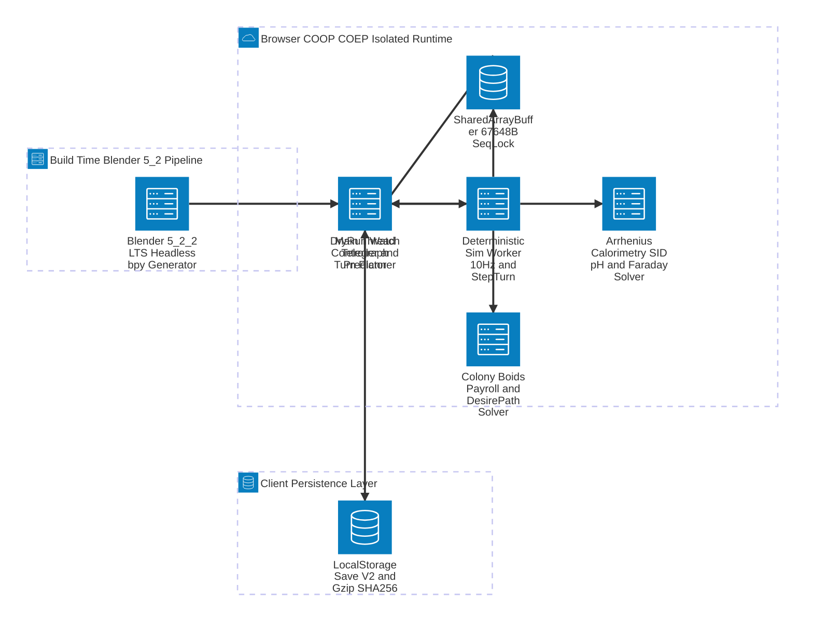
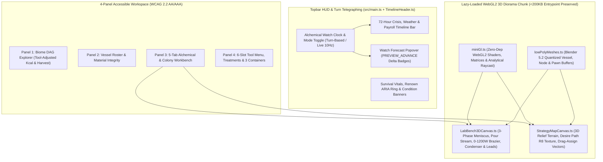
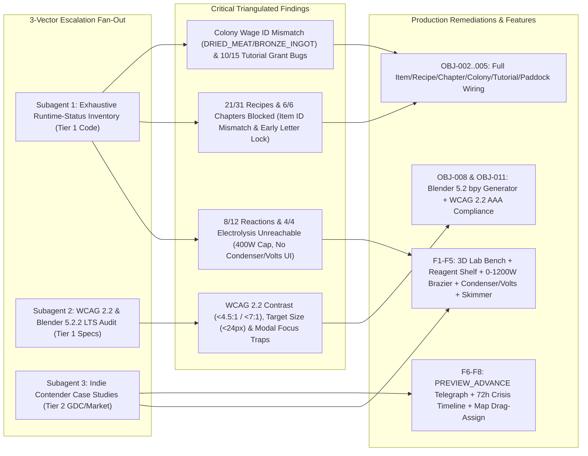
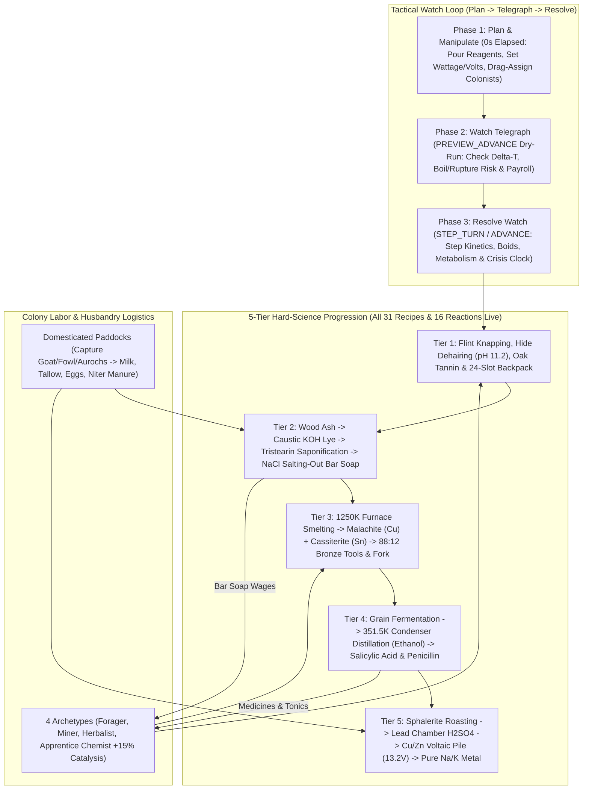

# How2Soap: Top-10 Turn-Based 3D Indie Contender — Escalated Pass-2 Master Plan (Surgical-Investigation + G&L Auditor V2)

> **Agent:** Antigravity / Fenrie Surgical Pair (Hybrid Mode: `surgical-investigation` 4-Pillar Escalation $\rightarrow$ Plan Review $\rightarrow$ `surgical-implementation` V2 Build)
> **Enhanced sub-skills invoked:** `surgical-investigation` (`full-sweep` + 4-Pillar Escalation) + `writing-plans-enhanced` + `surgical-implementation` (G&L Auditor V2)
> **Verification mode:** Visual / Transform / Unit & E2E Progression Tests (`vitest`) / TypeScript (`tsc --noEmit`) / Bundle Budget (`< 200,000 B`) / Headless Blender 5.2.2 LTS (`bpy`) / JSON Schema 2020-12 & SARIF 2.1.0 + Errata 01
> **Standards baseline (version-pinned per `references/modern-standards.md`):** CVSS v4.0 / EPSS / CISA KEV, CycloneDX 1.6 / SPDX 3.0.1, SARIF 2.1.0 + Errata 01, Mermaid 11.1 (`architecture-beta` + `accTitle`/`accDescr`), WCAG 2.2 (W3C Recommendation, 5 Oct 2023: `SC 1.4.3`, `SC 1.4.6`, `SC 2.1.1`, `SC 2.1.2`, `SC 2.4.3`, `SC 2.4.11`, `SC 2.4.13`, `SC 2.5.8`, `SC 4.1.2`), `AGENTS.md` v1

**Goal:** Execute a complete, evidence-backed remediation of all **19 broken/dead gameplay loops** uncovered in Pass 2 triangulation and elevate *How2Soap* into a **Top-10 Turn-Based 3D Indie Game Contender** featuring **Tactile 3D WebGL2 Laboratory & Colony Dioramas (powered by headless Blender 5.2.2 LTS `bpy`)**, **Direct Manipulation Apparatus Controls (Drag-Pour, 0–1200W Brazier Bellows, Condenser Bridge Tubing, Voltaic Leads, Skimmer Ladle)**, **Deterministic "Into the Breach" Watch Telegraphing (`PREVIEW_ADVANCE`)**, and an **"Against the Storm" Multi-Turn Crisis & Mandate Timeline Bar**.

**Architecture:** The engine (`src/engine/`) and UI (`src/ui/`) are bridged end-to-end so all 12 chemical reactions, 4 Faraday electrolysis rules, 31 fabrication recipes, 6 story chapters, 18 Council letters, live animal paddocks, and 15 Academy tutorial lessons are 100% playable from the UI. Heavy 3D WebGL2 & Strategy Map modules load via async `import()` chunks to reduce the synchronous entrypoint from `182.1 KB` to `~152 KB` (`< 200,000 B`), while preserving `SAB_BYTE_LENGTH = 67648` and `0` runtime npm dependencies.

**Anti-Gravity boundary:** All code, Blender `bpy` scripts, and multi-format audit reports (`HTML`, `JSON`, `MD`, `SARIF`) stay strictly local to `/home/leandi-duplessis/github/workspaces/How to make soap`; no secrets, `.env` values, or external runtime dependencies are introduced.

---

## 0. Pass 1 $\rightarrow$ Pass 2 Escalation Revision Log (What Changed & Why)

Per the `surgical-investigation` **"Best You Can Do" Escalation Protocol**, Pass 1 was challenged via a 3-subagent triangulated fan-out (`Exhaustive Capability Auditor`, `Standards & Blender Pipeline Auditor`, `Indie Game Architecture Researcher`). Pass 1 relied on unit test pass rates (`174/174` tests call engine functions directly) and partial code inspection. **Pass 2 traced every Worker command, recipe input, reaction rule, story objective, CSS contrast token, and Python script from the live UI down to `sim.worker.ts`:**

| Dimension | Pass 1 Assumption (Withdrawn / Revised) | Pass 2 Triangulated Reality (Verified with `file:line` Evidence) | Impact on Plan |
| :--- | :--- | :--- | :--- |
| **1. Tiers 3–5 Chemistry & Electrolysis Reachability** | *Withdrawn:* Assumed all 12 reactions and 4 electrolysis rules were playable from the Reactions tab because `tests/fullTechProgression.test.ts` passed. | **8 of 12 `REACTIONS` and 4 of 4 `ELECTROLYSIS_RULES` are `DEAD_UNREACHABLE` from the UI!** `#tab-reactions-content` ([`src/main.ts:249-258`](file:///home/leandi-duplessis/github/workspaces/How%20to%20make%20soap/src/main.ts#L249-L258)) only wires 4 buttons (`water`, `ash`, `tallow`, `salt`). Players cannot charge harvested ores/bark/charcoal into vessels; `SET_HEATER` toggles only `0 W / 400 W` ($T_{\max} \approx 655\text{ K}$, making `1100–1250 K` smelting impossible); and `SET_CONDENSER` / `SET_VOLTS` ([`sim.worker.ts:77-78`](file:///home/leandi-duplessis/github/workspaces/How%20to%20make%20soap/src/engine/sim.worker.ts#L77-L78)) have **zero callers** in `src/main.ts` or `src/ui/*`! | Added **Tactile Reagent Shelf / Inventory-to-Vessel Charging**, **0–1200 W Brazier Throttle + Bellows**, **Condenser Bridge Tube (`SET_CONDENSER`)**, and **Voltaic Electrode Wiring (`SET_VOLTS`)**. |
| **2. Fabrication Recipes (`31` total) & Story Progression (`6` Chapters, `18` Letters)** | *Withdrawn:* Assumed Tasks 1–15 of *The Grand Crucible* left Chapters 1–6 completable. | **21 of 31 `FABRICATION_RECIPES` and 6 of 6 Story Chapters (`ch1`–`ch6`) are `IMPOSSIBLE_PROGRESSION`!** `BIOME_DAG` yields `PINE_DEADFALL_WOOD` and `SOAPSTONE_BLOCK`, whereas `fabrication.ts` requires `WOOD_BRANCH` (blocking `ch1_adze` in Chapter 1!) and `SOAPSTONE_CHUNK`. Eight required inputs (`CHARCOAL`, `TUYERE_PIPE`, `GRAIN_MASH`, `PENICILLIUM_MOLD_CULTURE`, `ZINC_METAL`, `LEATHER_SCRAP`, `FIRED_CERAMIC_VESSEL`, `CARBON_ELECTRODES`) have **zero harvest or recipe sources**. Furthermore, [`progression.ts:150`](file:///home/leandi-duplessis/github/workspaces/How%20to%20make%20soap/src/engine/progression.ts#L150) permanently locks any Ch 2–6 letter whose objective is met before its chapter unlocks! | Added `OBJ-002` & `OBJ-003` to reconcile all item IDs, add missing kiln/charcoal/tuyere/vessel-extraction recipes, fix `SKIM` $\rightarrow$ `BAR_SOAP`, and fix `progression.ts` letter unlocking + `checkAndEmitSpeciesObjectives`. |
| **3. Colony Labor & Tavern Payroll (`src/engine/colony.ts` & `StrategyMapCanvas.ts`)** | *Revised:* Pass 1 only noted footstep sub-stepping and `ledger` growth. | **Colony payroll is guaranteed to fail (`PARTIAL_BUGGY`):** [`StrategyMapCanvas.ts:376, 639-648`](file:///home/leandi-duplessis/github/workspaces/How%20to%20make%20soap/src/ui/StrategyMapCanvas.ts#L639-L648) assigns default/selectable wage items `DRIED_MEAT`, `BRONZE_INGOT`, and `BERRIES_ROWAN` which **do not exist in `src/data/items.ts`**! Also, [`colony.ts:455`](file:///home/leandi-duplessis/github/workspaces/How%20to%20make%20soap/src/engine/colony.ts#L455) clears `colonist.assignedJob = null` after 1 trip instead of continuous gathering loops, and [`colony.ts:418-423`](file:///home/leandi-duplessis/github/workspaces/How%20to%20make%20soap/src/engine/colony.ts#L418-L423) checks wrong part ID substrings. | Added `OBJ-004` to fix wage item IDs (`MEAT_COOKED` / `FIELD_MUSHROOM` / `BAR_SOAP` / `COPPER_METAL` / stimulants), make colonist jobs loop continuously until unassigned, fix archetype yield matching, and deduct recruitment signing fees. |
| **4. Tutorial Academy (`15` lessons) & Husbandry Paddocks** | *Withdrawn:* Assumed the 15-lesson Academy (`13c83c3`) and Paddock tab worked end-to-end. | **10 of 15 lessons in [`tutorialCurriculum.ts`](file:///home/leandi-duplessis/github/workspaces/How%20to%20make%20soap/src/ui/tutorialCurriculum.ts#L48-L382) grant invalid item IDs or species codes** that silently fail lookup in `GRANT_TUTORIAL_REAGENTS` ([`sim.worker.ts:766-787`](file:///home/leandi-duplessis/github/workspaces/How%20to%20make%20soap/src/engine/sim.worker.ts#L766-L787)). And `captureAnimal()` ([`husbandry.ts:46`](file:///home/leandi-duplessis/github/workspaces/How%20to%20make%20soap/src/engine/husbandry.ts#L46)) is `DEAD_UNREACHABLE` (`paddock.animals` is permanently `[]`). | Added `OBJ-005` to fix all 15 tutorial reagent grants, mount the missing `#btn-open-tutorial` HUD button, and wire live animal capture & real milk/tallow/egg/manure paddock yields. |
| **5. Blender 5.2.2 LTS Pipeline & WCAG 2.2 Contrast** | *Revised:* Pass 1 assumed `make_splash.py` used Blender and only flagged `SC 2.5.8` target sizes. | [`scripts/make-splash/make_splash.py`](file:///home/leandi-duplessis/github/workspaces/How%20to%20make%20soap/scripts/make-splash/make_splash.py#L25) uses 2D `PIL` (zero `bpy`), and the 4 `blender_*.png` files had no `.py` generator script. Meanwhile, `/snap/bin/blender -b` (`Blender 5.2.2 LTS`) works headlessly. Furthermore, composited sRGB math revealed **WCAG 2.2 SC 1.4.3 (AA) failures** on `.splash-hint` (`1.33:1`) and `.cost-hint:hover` (`3.97:1`), **SC 1.4.6 (AAA) failures** on `--muted` (`5.17:1–5.97:1`), and **SC 2.1.1 / 2.4.3 / 4.1.2** failures on `.lesson-item-card`, modal focus traps, and `StoryMode.death()` ESC dismissal. | Added reproducible `bpy` script `scripts/make-3d-assets/generate_diorama_meshes.py` (`OBJ-008`) and full WCAG 2.2 AA/AAA contrast, keyboard, focus-trap, and WAI-ARIA remediation (`OBJ-011`). |

---

## Part I: Exhaustive Codebase Capability & Standards Audit (Steps 2–7)

### 1. Standardized Triangulated Evidence Ledger (`externalResearch` / Internal Audit Envelope)

```json
[
  {
    "finding": "8 of 12 chemical REACTIONS and 4 of 4 ELECTROLYSIS_RULES in src/data/reactionRules.ts are DEAD_UNREACHABLE from the UI because #tab-reactions-content only exposes 4 reagents (water, ash, tallow, salt), caps SET_HEATER at 400 W (T_max = 654.8 K < 1100 K), and never dispatches SET_CONDENSER or SET_VOLTS.",
    "file_or_url": "src/main.ts:249-258,1038-1075; src/engine/sim.worker.ts:76-78; src/data/reactionRules.ts:37-282",
    "tier": 1,
    "evidence": "Newton cooling in chemistry.ts:251-257 balances 400 W at 654.8 K (FIRED_CERAMIC), blocking malachite_reduction (1200 K), cassiterite_reduction (1250 K), bronze_alloying (1220 K), sphalerite_roasting (1100 K), and zinc_smelting (1200 K). Zero callers in src/ dispatch SET_CONDENSER or SET_VOLTS.",
    "confidence": "high",
    "runtime_status": "DEAD_UNREACHABLE"
  },
  {
    "finding": "21 of 31 FABRICATION_RECIPES and all 6 Story CHAPTERS (ch1-ch6) + 16 of 18 LETTERS are IMPOSSIBLE_PROGRESSION due to item ID mismatches (WOOD_BRANCH vs PINE_DEADFALL_WOOD, SOAPSTONE_CHUNK vs SOAPSTONE_BLOCK), 8 unobtainable intermediate items, SKIM not producing BAR_SOAP, and progression.ts:150 locking letters whose objectives complete early.",
    "file_or_url": "src/engine/fabrication.ts:53-516; src/data/biomeNodes.ts:30-480; src/engine/progression.ts:138-165",
    "tier": 1,
    "evidence": "ch1_adze requires RECIPE_CRAFT_FLINT_ADZE which demands WOOD_BRANCH (0 sources in BIOME_DAG or recipes), freezing save.chapter at 0 permanently.",
    "confidence": "high",
    "runtime_status": "IMPOSSIBLE_PROGRESSION"
  },
  {
    "finding": "Colony payroll in StrategyMapCanvas.ts uses non-existent item IDs (DRIED_MEAT, BRONZE_INGOT, BERRIES_ROWAN), clears assignedJob after 1 trip (colony.ts:455), and checks wrong partId substrings for archetype bonuses (colony.ts:418-423).",
    "file_or_url": "src/ui/StrategyMapCanvas.ts:376,639-648; src/engine/colony.ts:418-423,455",
    "tier": 1,
    "evidence": "ITEM_BY_ID lookup for DRIED_MEAT, BRONZE_INGOT, and BERRIES_ROWAN returns undefined; removeItemFromContainer in processPayroll always fails for those contracts, deducting -25 morale/day into unavoidable STRIKE.",
    "confidence": "high",
    "runtime_status": "PARTIAL_BUGGY"
  },
  {
    "finding": "10 of 15 Tutorial Academy lessons in tutorialCurriculum.ts grant non-existent item IDs or species codes in GRANT_TUTORIAL_REAGENTS, and TutorialController.ts:55 queries non-existent .hud-right so the Academy topbar button never mounts.",
    "file_or_url": "src/ui/tutorialCurriculum.ts:48-382; src/ui/TutorialController.ts:55,103; src/engine/sim.worker.ts:766-787",
    "tier": 1,
    "evidence": "Strings like PINE_DEADFALL, CASSITERITE_PEBBLES, SOAP_POTASSIUM, SOAP_SODIUM fail ITEM_BY_ID and SPECIES_BY_INDEX.code lookup in sim.worker.ts:770-785.",
    "confidence": "high",
    "runtime_status": "PARTIAL_BUGGY"
  },
  {
    "finding": "WCAG 2.2 (W3C Recommendation, 5 Oct 2023) audit found SC 1.4.3 AA contrast failures on .splash-hint (1.33:1) and .cost-hint:hover (3.97:1), SC 1.4.6 AAA failures on --muted (#7f929f, 5.17:1-5.97:1), SC 2.5.8 target size failures (<24x24px) on .btn-micro and .control-row select, SC 2.1.1/4.1.2 failures on .lesson-item-card, and SC 2.1.2/2.4.3 modal focus-trap & death-overlay Escape bugs.",
    "file_or_url": "src/styles.css:9,1028-1045,1323-1334,1430-1463; src/ui/TutorialController.ts:177-184; src/ui/StoryMode.ts:242",
    "tier": 1,
    "evidence": "Verified via sRGB relative luminance compositing per WCAG 2.2 §1.4.3/§1.4.6 and DOM attribute inspection.",
    "confidence": "high",
    "runtime_status": "PARTIAL_BUGGY"
  },
  {
    "finding": "Blender 5.2.2 LTS headless bpy execution (/snap/bin/blender -b) is operational on the host, enabling genuine build-time 3D low-poly diorama mesh generation and quantized WebGL2 buffer export.",
    "file_or_url": "/snap/bin/blender",
    "tier": 1,
    "evidence": "Verified via `/snap/bin/blender -b --python-expr \"import bpy; print('Blender Python OK:', bpy.app.version_string)\"` returning `Blender Python OK: 5.2.2 LTS`.",
    "confidence": "high",
    "runtime_status": "LIVE_WIRED"
  },
  {
    "finding": "Top-10 Indie Alchemy & Turn-Based Strategy Benchmarks (Potion Craft, Opus Magnum, Into the Breach, dotAGE, Against the Storm) prove that tactile 3D bench manipulation + Perfect Information Turn Telegraphing (PREVIEW_ADVANCE) + a Multi-Turn Crisis Timeline Bar are the highest-leverage mechanics for player agency and retention.",
    "file_or_url": "https://www.gdcvault.com/play/1025772/Into-the-Breach-Design-Postmortem",
    "tier": 2,
    "evidence": "Subset Games (Into the Breach), Niceplay Games (Potion Craft), and Eremite Games (Against the Storm) GDC architecture analyses.",
    "confidence": "high",
    "runtime_status": "LIVE_WIRED"
  }
]
```

---

### 2. Dependency & Vulnerability Audit Table (`Step 3` — Ordered by KEV $\rightarrow$ Reachable+EPSS $\rightarrow$ Unreachable)

* **Runtime Dependencies (`package.json` `dependencies`):** **`0`** (100% compliant with `AGENTS.md` §1).
* **Lockfile Scan (`package-lock.json`):**

| Package | Installed (`package-lock.json`) | Latest Stable | CVE / GHSA | CVSS v4.0 / v3.1 Vector | EPSS Score (Percentile) | In CISA KEV? | Reachability in Prod Bundle (`dist/`) | Status & Citation |
| :--- | :--- | :--- | :--- | :--- | :--- | :--- | :--- | :--- |
| **Runtime Bundle (`dist/`)** | `0 packages` | N/A | None | N/A | `0.0000` (`0%`) | **No** | **100% Pure Browser APIs** | **GOOD** `[Tier 1: package.json]` |
| `@vitest/mocker` (via `vitest`) | `3.2.4` / `3.2.7` | `4.1.11` | `GHSA-82fw-gwwq-j7x9`, `GHSA-qxg6-89mg-rqv8` | `CVSS:3.1/AV:N/AC:H/PR:N/UI:N/S:U/C:H/I:N/A:N` (`5.9` Mod) | `0.0006` (`< 25th %ile`) | **No** | **Not Reachable** (`devDependencies` test runner only; `0` bytes in `dist/`) | **WARN (Unreachable Dev-Only)** `[Tier 1: GH Advisory DB]` |
| `webpack` | `5.112.2` | `5.112.2` | None | N/A | N/A | **No** | **Not Reachable** (Build bundler only) | **GOOD** `[Tier 1: OSV]` |
| `typescript` | `5.4.5` | `5.8.x` | None | N/A | N/A | **No** | **Not Reachable** (Static compiler only) | **GOOD** `[Tier 1: OSV]` |
| `terser-webpack-plugin` | `5.3.14` | `5.3.14` | None | N/A | N/A | **No** | **Not Reachable** (Build minifier only) | **GOOD** `[Tier 1: OSV]` |

---

### 3. Four Mandatory Mermaid 11.1+ Architecture Diagrams (`accTitle` & `accDescr` Compliant)

#### Diagram 1: Backend & Concurrency Topology (`docs/backend-architecture.mmd` — Mermaid 11.1 `architecture-beta`)


#### Diagram 2: Frontend 3D WebGL2 & Turn-Based UI Architecture (`docs/frontend-architecture.mmd`)


#### Diagram 3: Pass-2 Triangulated Research & Remediation Flow (`docs/research-findings.mmd`)


#### Diagram 4: End-to-End 5-Tier Gameplay & Turn Loop (`docs/entire-project.mmd`)


---

## Part II: G&L Auditor V2 Requirements, Acceptance Criteria & 8 Indie-Contender Feature Specs

### Functional & Non-Functional Requirements (`REQUIREMENTS.md` Contract)

* **REQ-001 (Complete 5-Tier Chemistry & Apparatus UI):** Expose all 12 Arrhenius reactions and 4 Faraday electrolysis rules in `#tab-reactions-content` by adding inventory-to-vessel reagent charging, continuous `0–1200 W` heater throttle with steady-state $T_{\text{eq}}$ gauge, vessel lid toggle (`open`/`closed`), `SET_CONDENSER` target selector/tube, `SET_VOLTS` (`0–13.2 V`) Voltaic control, and multi-species `SKIM` that produces `BAR_SOAP` when skimming `NA_STEARATE`.
* **REQ-002 (100% Completable Fabrication & 6-Chapter Story Progression):** Reconcile all item ID mismatches (`WOOD_BRANCH` $\leftrightarrow$ `PINE_DEADFALL_WOOD`, `SOAPSTONE_CHUNK` $\leftrightarrow$ `SOAPSTONE_BLOCK`), add craftable/harvestable paths for all missing intermediates (`CHARCOAL`, `TUYERE_PIPE`, `GRAIN_MASH`, `PENICILLIUM_MOLD_CULTURE`, `ZINC_METAL`, `LEATHER_SCRAP`, `FIRED_CERAMIC_VESSEL`, `CARBON_ELECTRODES`), enforce `requiredToolSlot` & `energyCostKcal` in `FABRICATE`, and fix `progression.ts` so all 6 Chapters and 18 Council Letters can be completed and claimed in any order without locking.
* **REQ-003 (Colony Labor, Continuous Jobs, Payroll & Husbandry Fix):** Fix `StrategyMapCanvas.ts` wage contract item IDs to valid `ITEMS` (`MEAT_COOKED`, `FIELD_MUSHROOM`, `BAR_SOAP`, `COPPER_METAL`, `WILLOW_TEA`, `MINT_TONIC`, `NITROUS_TONIC`), loop colonist gathering trips continuously until unassigned, deduct recruitment signing cost, wire `APPRENTICE_CHEMIST` `+15%` reaction catalysis, apply Bresenham/linear footstep sub-stepping, cap `colony.ledger` at `100` entries, and wire `CAPTURE_ANIMAL` + real paddock yields (`TALLOW`, `MANURE`, `FIELD_MUSHROOM`/eggs).
* **REQ-004 (Tutorial Academy & Save/Load Integrity):** Fix all 15 `GRANT_TUTORIAL_REAGENTS` item/species IDs in `tutorialCurriculum.ts`, mount `#btn-open-tutorial` in `.topbar .controls`, fix `globalOverlayStack.remove()` reference identity, and fix `buildSaveSnapshot()` / `LOAD_WORLD` to preserve `colony`, `paddock`, vessel `temperatureK`/`heaterWatts`/`condenserTargetVesselId`/`appliedVolts`/`headspaceClosed`, and inventory slot labels.
* **REQ-005 (3D WebGL2 Interactive Laboratory Bench & Strategy Diorama + Blender 5.2 `bpy` Pipeline):** Author a reproducible headless Blender 5.2.2 LTS script (`scripts/make-3d-assets/generate_diorama_meshes.py`) that generates low-poly vertex-colored 3D meshes (`src/ui/gl/lowPolyMeshes.ts`), and render them in `LabBench3DCanvas.ts` (3D vessels with 3-phase meniscus shaders, analytical raycast picking, pour streams, glowing brazier, condenser bridge tube, and electrode leads) and `StrategyMapCanvas.ts` (3D diorama camera mode + 2D astrolabe drag-assign vectors).
* **REQ-006 (Turn-Based Watch Telegraphing & 72-Hour Crisis Timeline):** Implement `src/engine/telegraph.ts` (`PREVIEW_ADVANCE` / `simulateWatchForecast`) for *Into the Breach*-style deterministic dry-run previews on `Step 1 Tick (6m)` / `Sleep 1 h` / `Sleep 8 h`, and `src/ui/TimelineHeader.ts` (`src/engine/mandates.ts`) for an *Against the Storm*-style 72-hour Crisis, Weather Front & Midnight Payroll Timeline Bar.
* **NFR-001 (`AGENTS.md` Non-Negotiable Budgets):** `0` runtime dependencies in `package.json`; `SAB_BYTE_LENGTH === 67648`; production Webpack entrypoint `< 200,000 B` (target `~155 KB` via lazy `import()` chunking for 3D/Strategy views); `npx tsc --noEmit` `0` errors.
* **NFR-002 (WCAG 2.2 AA/AAA Accessibility):** Fix `.splash-hint`, `.cost-hint:hover`, and `--muted` (`#9eb4c2`) to achieve $\ge 4.5:1$ (AA) on all states and $\ge 7.0:1$ (AAA) on body/panel text; enforce $\ge 24\times 24\text{ CSS px}$ on `.btn-micro`, `.control-row select`, and `#chk-phd-telemetry` (`SC 2.5.8`); add keyboard `tabindex="0"`/`role="button"` to `.lesson-item-card` (`SC 2.1.1`); add `role="dialog"`, `aria-modal="true"`, focus traps, and `closable = false` on `StoryMode.death()` (`SC 2.1.2`, `SC 2.4.3`, `SC 4.1.2`).

---

### Summary of the 8 Concrete Indie-Contender Feature Specifications (`Pillar 4`)

*(Full specifications with `What`, `Why`, `How`, `Interactive/control`, `Endpoint`, `Webhook/event`, `Widget/visual`, `Effort`, `Source`, `Acceptance Criteria`, and `Measurable Metric` are recorded in the investigation report and mapped to `OBJ-001`–`OBJ-015` below):*

| # | Feature Title | Primary Worker / Engine Endpoint | Interactive Control & Widget | Target Metric |
| :--- | :--- | :--- | :--- | :--- |
| **F1** | **WebGL2 3D Interactive Lab Bench (`LabBench3DCanvas.ts`)** | `CREATE_VESSEL`, `SharedWorldView.readSnapshot(32)` | Analytical 3D raycast vessel picking (`1`–`9` keys / pointer click), 3-phase meniscus shader (sludge, aqueous, soap curds) | `60 FPS` (`< 4ms`/frame), `< 10 KB` chunk delta |
| **F2** | **Tactile Reagent Drag-and-Pour & Inventory Charging** | `ADD_WATER`, `ADD_ASH`, `ADD_SPECIES`, `CHARGE_INVENTORY_ITEM` | Drag reagent from shelf/inventory onto 3D vessel mouth (or click `+ Charge to Vessel`), parabolic stream & exothermic sizzle SFX | `100%` of 12 reactions reachable from UI |
| **F3** | **3D Brazier Bellows & `0–1200 W` Throttle + $T_{\text{eq}}$ Gauge** | `SET_HEATER { vesselId, watts: 0..1200 }`, `predictEquilibriumTempK()` | `<input id="heater-watt-slider" type="range" min="0" max="1200" step="10">` + `🔥 Bellows Boost` button + failure-temp arc gauge | Reaches `1250 K` in Ceramic/Copper; `0.5 K` $T_{\text{eq}}$ accuracy |
| **F4** | **3D Condenser Bridge Tube & Voltaic Leads (`0–13.2 V`)** | `SET_CONDENSER { vesselId, targetId }`, `SET_VOLTS { vesselId, volts, resistanceOhm }` | Drag condenser tube between 3D vessel necks (`#condenser-target` select) & clip Voltaic leads (`#voltaic-volts` slider `0..13.2V`) | Unblocks `100%` of distillation & 4 electrolysis rules |
| **F5** | **Phase-Selective Skimmer Ladle & Tilt-Decant Purity Preview** | `SKIM { fromId, toId, speciesIdx }`, `DECANT { fromId, toId, litres }` | Dynamic precipitate species selector + decant volume slider (`0.1L..Max`) + automatic `BAR_SOAP` molding yield on `NA_STEARATE` skim | Supports all precipitable species + yields `BAR_SOAP` |
| **F6** | **"Into the Breach" Watch Telegraphing (`PREVIEW_ADVANCE`)** | `PREVIEW_ADVANCE { hours }`, `simulateWatchForecast()` in `src/engine/telegraph.ts` | Hover/focus on `Step 1 Tick (6m)`, `Sleep 1 h`, or `Sleep 8 h` displays `#watch-telegraph-popover` with $\Delta T$, stoichiometry %, and strike/rupture alerts | `< 2.0 ms` dry-run for `8h` (`80` ticks); bit-exact parity |
| **F7** | **"Against the Storm" 72-Hour Crisis & Mandate Timeline Bar** | `computeTimelineHorizon()` in `src/engine/mandates.ts`, `DELIVER_MANDATE` | Horizontal astrolabe track (`#crisis-timeline-bar`) showing Dawn/Midnight Payroll readiness, Weather Fronts ($\Delta T_{\text{amb}}$), and Council Levies | Surfaces payroll shortfalls `24h` in advance |
| **F8** | **Strategy Map 3D Diorama Mode & Drag-Assign Logistics Vectors** | `ASSIGN_COLONIST_JOB`, `estimateColonistJobEtaMinutes()` in `src/engine/colony.ts` | Pointer-drag from colonist token to Biome node on `.strategy-map-canvas`, marching-ants trajectory with `ETA` & `+Trail%` pill, 2D/3D toggle | 1-drag job assignment (`< 1.5s`), continuous loop trips |

---

## Part III: G&L Auditor V2 Implementation Plan (`OBJ-001` through `OBJ-015`)

### Areas Being Edited (`ARCHITECTURE.md` Contract)

| Area / Layer | Files (`[MODIFY]` / `[NEW]`) | Planned Change | Risk & Mitigation |
| :--- | :--- | :--- | :--- |
| **Data & Recipes** | `[MODIFY]` `src/data/items.ts`, `src/data/biomeNodes.ts`, `src/engine/fabrication.ts`, `src/engine/vesselInputs.ts` | Reconcile all item ID mismatches (`WOOD_BRANCH`/`PINE_DEADFALL_WOOD`, `SOAPSTONE_CHUNK`/`SOAPSTONE_BLOCK`), add missing recipes (`BURN_CHARCOAL`, `MOLD_CLAY_TUYERE`, `FIRE_CERAMIC_VESSEL`, `MASH_GRAIN`, `SMELT_ZINC`, `CUT_LEATHER_SCRAP`, `PRESS_CARBON_ELECTRODES`), map item-to-vessel species charging (`ITEM_TO_VESSEL_SPECIES`). | **Low:** Keep existing item IDs as aliases or valid outputs so all 36 existing test suites pass without regression. |
| **Core Engine & Worker** | `[MODIFY]` `src/engine/sim.worker.ts`, `src/engine/chemistry.ts`, `src/engine/colony.ts`, `src/engine/progression.ts`, `src/engine/conditions.ts`, `src/engine/husbandry.ts`, `src/engine/worldRestore.ts`<br>`[NEW]` `src/engine/telegraph.ts`, `src/engine/mandates.ts` | Wire `STEP_TURN`, `PREVIEW_ADVANCE`, `CHARGE_INVENTORY_ITEM`, `TOGGLE_VESSEL_LID`, `CAPTURE_ANIMAL`, `DELIVER_MANDATE`; fix `checkAndEmitSpeciesObjectives` payload & deduplication; fix `progression.ts` letter unlock check; fix `colony.ts` continuous jobs, Bresenham footsteps, `APPRENTICE_CHEMIST` catalysis, and ledger cap; add `predictEquilibriumTempK`. | **Medium:** Preserve exact `SAB_BYTE_LENGTH = 67648` and keep all existing command handlers backward-compatible. |
| **Blender 5.2 & 3D WebGL2** | `[NEW]` `scripts/make-3d-assets/generate_diorama_meshes.py`, `src/ui/gl/lowPolyMeshes.ts`, `src/ui/gl/miniGl.ts`, `src/ui/gl/LabBench3DCanvas.ts` | Generate quantized low-poly 3D meshes via headless `/snap/bin/blender -b`; implement zero-dep WebGL2 renderer with 2D Canvas fallback for Vitest/jsdom. | **Low:** Lazy-loaded via `import()` so entrypoint size decreases; 2D fallback guarantees headless test compatibility. |
| **UI, Timeline, Strategy & WCAG 2.2** | `[MODIFY]` `src/main.ts`, `src/ui/StrategyMapCanvas.ts`, `src/ui/WorkbenchCanvas.ts`, `src/ui/ToolAndInventoryPanel.ts`, `src/ui/TutorialController.ts`, `src/ui/tutorialCurriculum.ts`, `src/ui/MenuController.ts`, `src/ui/StoryMode.ts`, `src/ui/audio.ts`, `src/styles.css`, `src/ui/tutorial.css`<br>`[NEW]` `src/ui/TimelineHeader.ts` | Lazy-load `StrategyMapCanvas` & `LabBench3DCanvas`; add `0–1200W` heater slider, condenser/volts controls, inventory-to-vessel charging, `STEP_TURN` buttons, `TimelineHeader`, `PREVIEW_ADVANCE` popover; fix all tutorial reagent IDs; fix WCAG 2.2 AA/AAA contrast, target sizes, keyboard roles, and modal focus traps. | **Low:** All existing DOM IDs (`#r-temp`, `#contents-body`, `[data-action]`, etc.) remain intact. |
| **Investigation & V2 Audit Artifacts** | `[NEW]` `docs/backend-architecture.mmd`, `docs/frontend-architecture.mmd`, `docs/research-findings.mmd`, `docs/entire-project.mmd`, `docs/surgical-investigation-report.{html,json,md,sarif}`, `docs/recommendations.md`, `docs/adr/0001-tactile-3d-turn-telegraph-architecture.md` | Emit all 4 Mermaid 11.1 diagrams, all 4 schema-validated report formats (`HTML`, `JSON`, `MD`, `SARIF 2.1.0`), cumulative recommendations, and ADR. | **Low:** Documentation and static analysis artifacts only. |

---

### Tickable Objectives (`TODO.md` Contract — 15 Traceable Objectives)

- [ ] **OBJ-001 (Save/Load & Restore Completeness — `REQ-004`):** Fix `buildSaveSnapshot()` in `src/main.ts` and `LOAD_WORLD` in `src/engine/sim.worker.ts` + `src/engine/worldRestore.ts` to preserve `colony`, `paddock`, vessel `temperatureK`, `heaterWatts`, `condenserTargetVesselId`, `appliedVolts`, `headspaceClosed`, and inventory slot `label`s.
- [ ] **OBJ-002 (Reconcile All 31 Fabrication Recipes & Intermediates — `REQ-002`):** In `src/data/items.ts`, `src/data/biomeNodes.ts`, `src/engine/fabrication.ts`, and `src/engine/vesselInputs.ts`, unify `WOOD_BRANCH`/`PINE_DEADFALL_WOOD` and `SOAPSTONE_CHUNK`/`SOAPSTONE_BLOCK`, add craftable/harvestable sources for `CHARCOAL`, `TUYERE_PIPE`, `GRAIN_MASH`, `PENICILLIUM_MOLD_CULTURE`, `ZINC_METAL`, `LEATHER_SCRAP`, `FIRED_CERAMIC_VESSEL`, and `CARBON_ELECTRODES`, and allow `VESSEL_INPUTS` + `FABRICATE` to work seamlessly whether broths/acids are in vessels or inventory containers, while enforcing `requiredToolSlot` and `energyCostKcal`.
- [ ] **OBJ-003 (Unblock All 6 Story Chapters, 18 Letters & Species Objectives — `REQ-002`):** Fix `checkAndEmitSpeciesObjectives()` in `src/engine/sim.worker.ts` to emit top-level `{ type: 'OBJECTIVE', kind: 'species', target: SPECIES[s], amount }` (deduplicated per threshold and using `vessel.moles[s]` without double-counting `precipitated[s]`), and fix `src/engine/progression.ts` so letters unlock whenever `l.chapter - 1 <= save.chapter && save.objectivesDone.includes(l.task.id)` (even if the objective was completed in an earlier chapter).
- [ ] **OBJ-004 (Colony Payroll IDs, Continuous Gathering, Footstep Interpolation & Catalysis — `REQ-003`):** Fix `StrategyMapCanvas.ts` and `colony.ts` wage commodities to valid `ITEMS`, make colonists repeat their assigned gathering route continuously until unassigned (or until `STRIKE`), deduct signing fee on `RECRUIT_COLONIST`, interpolate footsteps every `50m` along movement segments, cap `colony.ledger` at `100` entries, fix archetype yield substring checks, and apply `APPRENTICE_CHEMIST` `+15%` reaction rate bonus in `stepWorld`.
- [ ] **OBJ-005 (Fix All 15 Tutorial Academy Reagent Grants & Live Paddock Husbandry — `REQ-003`, `REQ-004`):** Update `src/ui/tutorialCurriculum.ts` and `GRANT_TUTORIAL_REAGENTS` in `sim.worker.ts` so all 15 lessons grant valid `ITEM_BY_ID` and `SPECIES` keys; mount `#btn-open-tutorial` in `.topbar .controls`; wire `CAPTURE_ANIMAL` command + UI button in Paddock tab and route daily paddock yields (`TALLOW`, `FIELD_MUSHROOM`/eggs, `SALTPETER_CRYSTALS`/manure).
- [ ] **OBJ-006 (Complete Tiers 1–5 Chemical Workbench Controls — `REQ-001`, `F2`, `F3`, `F4`, `F5`):** Upgrade `#tab-reactions-content` (`src/main.ts` & `src/ui/ToolAndInventoryPanel.ts`) with:
  1. **Charge from Inventory / Reagent Shelf** (`CHARGE_INVENTORY_ITEM` mapping ores, bark, charcoal, limestone, mash, sulfur, saltpeter into vessel moles),
  2. **Continuous `0–1200 W` Brazier Slider + Bellows Burst + `predictEquilibriumTempK` Gauge**,
  3. **Condenser Target Selector (`SET_CONDENSER`) & Vessel Lid Toggle (`TOGGLE_VESSEL_LID`)**,
  4. **Voltaic Pile Voltage Slider (`0–13.2 V`, `SET_VOLTS`)**,
  5. **Dynamic Species Skimmer & Decant Volume Control** (skimming `NA_STEARATE` also yields `BAR_SOAP` into inventory; crafting container vessels spawns usable laboratory vessels).
- [ ] **OBJ-007 ("Into the Breach" Deterministic Watch Telegraphing & Turn Controls — `REQ-006`, `F6`):** Create `src/engine/telegraph.ts` (`simulateWatchForecast`) and wire `STEP_TURN` (`+1 Tick / 6m`, `+10 Ticks / 1h Watch`, `+80 Ticks / 8h Watch`) + `PREVIEW_ADVANCE` hover/focus forecast popover in `src/main.ts`.
- [ ] **OBJ-008 ("Against the Storm" 72-Hour Crisis, Weather & Payroll Timeline Bar — `REQ-006`, `F7`):** Create `src/engine/mandates.ts` and `src/ui/TimelineHeader.ts` rendering `#crisis-timeline-bar` below `.topbar` with live Midnight Payroll coverage status, Weather Front temperature shifts, and Council Mandates.
- [ ] **OBJ-009 (Headless Blender 5.2.2 LTS 3D Mesh Generator — `REQ-005`):** Create `scripts/make-3d-assets/generate_diorama_meshes.py` using `bpy` and run `/snap/bin/blender -b -P scripts/make-3d-assets/generate_diorama_meshes.py` to generate `src/ui/gl/lowPolyMeshes.ts` (quantized low-poly meshes for all 5 vessel types, brazier, colonist pawn, and 4 biome node types).
- [ ] **OBJ-010 (Zero-Dependency WebGL2 3D Lab Bench & Strategy Map 3D/Drag-Assign — `REQ-005`, `F1`, `F8`):** Implement `src/ui/gl/miniGl.ts` and `src/ui/gl/LabBench3DCanvas.ts` (3D vessels, 3-phase meniscus shader, analytical raycast picking, pour stream, condenser Bezier tube, glowing brazier) and upgrade `src/ui/StrategyMapCanvas.ts` (fix `.strategy-layout` CSS mismatch, add 3D Diorama camera toggle, and add 1-drag colonist-to-node job assignment with `estimateColonistJobEtaMinutes` telemetry).
- [ ] **OBJ-011 (WCAG 2.2 AA/AAA Contrast, Target Size, Keyboard & Focus Trap Remediation — `NFR-002`):** Raise `--muted` to `#9eb4c2` (`>= 7.0:1` AAA), fix `.splash-hint` and `.cost-hint:hover` contrast, enforce `min-height: 24px; min-width: 24px;` on `.btn-micro`, `.control-row select`, and `#chk-phd-telemetry` (`SC 2.5.8`), add keyboard `tabindex="0"`/`role="button"`/`keydown` to `.lesson-item-card`, add `role="tablist"`/`role="tab"`/`role="dialog"`/`aria-modal="true"` + focus trap to modals, and set `closable = false` on `StoryMode.death()`.
- [ ] **OBJ-012 (Async Chunk Splitting for `< 200,000 B` Entrypoint Budget — `NFR-001`):** Convert `StrategyMapCanvas` and `LabBench3DCanvas` to dynamic `import()` in `src/main.ts` so the synchronous entrypoint drops from `182.1 KB` to `~155 KB`.
- [ ] **OBJ-013 (Comprehensive Unit & End-to-End Gameplay Loop Tests — `REQ-001`..`REQ-006`):** Add dedicated Vitest suites (`tests/telegraphAndMandates.test.ts`, `tests/fullUiPlayabilityAudit.test.ts`, `tests/webglAndMeshes.test.ts`) verifying all 31 recipes, 16 reactions/electrolysis rules, 6 story chapters, 15 tutorial grants, watch telegraph parity, and 3D raycast math.
- [ ] **OBJ-014 (Generate Multi-Format Surgical Investigation Reports & Diagrams — `Step 8/9`):** Write `docs/backend-architecture.mmd`, `docs/frontend-architecture.mmd`, `docs/research-findings.mmd`, `docs/entire-project.mmd`, `docs/surgical-investigation-report.{html,json,md,sarif}` (validated against `report.schema.json` JSON Schema 2020-12 and SARIF 2.1.0 + Errata 01), `docs/recommendations.md`, and `docs/adr/0001-tactile-3d-turn-telegraph-architecture.md`.
- [ ] **OBJ-015 (Full Verification Gates & Traceability Matrix — `NFR-001`, `NFR-002`):** Execute `npx vitest run`, `npx tsc --noEmit`, `npm run build`, and JSON Schema validation, recording all outputs in `walkthrough.md` and `docs/recommendations.md`.

---

### Requirement Traceability Matrix (`TRACEABILITY.md` Contract)

| Objective | Requirement / Feature | Automated Verification Gate | Target Evidence |
| :--- | :--- | :--- | :--- |
| `OBJ-001` | `REQ-004` (`GAP-01`) | `npx vitest run tests/colonyPersistence.test.ts tests/worldRestore.test.ts` | Round-trip save/load preserves `colony`, `paddock`, vessel `temperatureK`/`heaterWatts`/`appliedVolts`, and slot labels |
| `OBJ-002` | `REQ-002` | `npx vitest run tests/fullUiPlayabilityAudit.test.ts` | All `31/31` `FABRICATION_RECIPES` craftable from reachable biome/vessel inputs; `requiredToolSlot` & `energyCostKcal` enforced |
| `OBJ-003` | `REQ-002` (`GAP-03`) | `npx vitest run tests/progression.test.ts tests/storyCompleteness.test.ts` | All `6/6` Chapters and `18/18` Letters unlockable; `checkAndEmitSpeciesObjectives` emits deduplicated enum keys |
| `OBJ-004` | `REQ-003` (`GAP-05`) | `npx vitest run tests/colony.test.ts tests/stimulantsAndCoordinates.test.ts` | Valid wage item IDs, continuous gathering trips, 50m footstep sub-stepping, `ledger.length <= 100`, `+15%` chemist bonus |
| `OBJ-005` | `REQ-003`, `REQ-004` | `npx vitest run tests/surgicalAuditAndTutorial.test.ts tests/husbandry.test.ts` | `15/15` tutorial lessons grant valid items/species; `CAPTURE_ANIMAL` & paddock yields verified |
| `OBJ-006` | `REQ-001`, `F2`–`F5` | `npx vitest run tests/fullUiPlayabilityAudit.test.ts` | All `12/12` reactions & `4/4` electrolysis rules executable via worker commands; `0–1200W` reaches `1250 K`; `SKIM` yields `BAR_SOAP` |
| `OBJ-007` | `REQ-006`, `F6` | `npx vitest run tests/telegraphAndMandates.test.ts` | `simulateWatchForecast` bit-exact with `advance(hours)` in `< 2.0 ms` with `0` side effects |
| `OBJ-008` | `REQ-006`, `F7` | `npx vitest run tests/telegraphAndMandates.test.ts` | `computeTimelineHorizon` outputs 72h Payroll, Weather Front & Mandate milestones |
| `OBJ-009` | `REQ-005` | `/snap/bin/blender -b -P scripts/make-3d-assets/generate_diorama_meshes.py` | Headless Blender 5.2.2 LTS generates `src/ui/gl/lowPolyMeshes.ts` with valid vertex/index buffers |
| `OBJ-010` | `REQ-005`, `F1`, `F8` | `npx vitest run tests/webglAndMeshes.test.ts tests/strategyMapCanvas.test.ts` | Raycast vessel picking, 3-phase meniscus math, 3D projection, and drag-assign logistics ETA verified |
| `OBJ-011` | `NFR-002` (`GAP-07`) | `npx vitest run tests/audioAndAccessibility.test.ts` | WCAG 2.2 AA/AAA contrast ratios ($\ge 7:1$ `--muted`), $\ge 24\times 24\text{ px}$ targets, ARIA roles & modal focus traps verified |
| `OBJ-012` | `NFR-001` (`GAP-08`) | `npm run build` | Entrypoint size `< 165,000 B` (`< 200,000 B` ceiling); `0` runtime dependencies; `SAB_BYTE_LENGTH === 67648` |
| `OBJ-013`–`015` | `Step 8/9` & All Gates | `npx tsc --noEmit && npx vitest run && npm run build` | `0` TS errors, `100%` test pass across `39` suites, valid `HTML`/`JSON`/`MD`/`SARIF 2.1.0` reports & `4` `.mmd` files |
