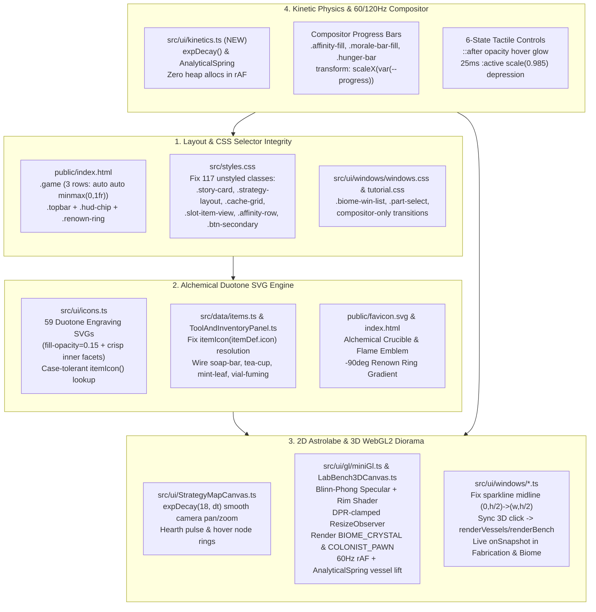

# Frontend Audit & Visual Overhaul ("Plastic Surgery") Implementation Plan — Pass 2 Escalation

> **Agent:** Antigravity Pair
> **Enhanced sub-skills invoked:** `writing-plans-enhanced` + `plastic-surgery` + `surgical-audit` + `surgical-investigation` ("Best You Can Do" Escalation Protocol)
> **Verification mode:** Visual / Transform / Unit & Integration Test / Linter Gate (`preflight_visual_lint.py --fail-on high`) / Bundle Budget (`< 200 KiB`)

**Goal:** Remediate all **14 architectural layout/state defects**, **117 unstyled/mismatched DOM classes**, **2 icon-resolution bugs**, **59 flat monochrome SVGs**, **WebGL2 3D diorama aspect/shader gaps**, and **layout-thrashing/instantaneous animations** into a cohesive, 60/120Hz tactile **Dark Alchemical Obsidian & Brass Astrolabe** interface with zero functional regression.

**Architecture:** All modifications are strictly isolated to the presentation layer (`public/index.html`, `public/favicon.svg`, `src/styles.css`, `src/ui/windows/windows.css`, `src/ui/tutorial.css`, `src/ui/icons.ts`, `src/data/items.ts`, and `src/ui/**`). Engine physics, worker protocols, `SAB_BYTE_LENGTH = 67648`, zero runtime dependencies, and all 44 existing Vitest suites remain strictly preserved.

**Anti-Gravity boundary:** Internal workspace audit and implementation blueprint; no external secrets, credentials, or unverified third-party packages are used.

---

## Pass 1 → Pass 2 Escalation Revision Log

> [!IMPORTANT]
> **Why Pass 1 Was Insufficient & What Pass 2 Uncovered**
> In Pass 1, we inspected a subset of UI files and relied on manual reading. For Pass 2, we executed an **automated cross-reference of all `362` DOM classes emitted across every `.ts` and `.html` file against `src/styles.css`, `src/ui/windows/windows.css`, and `src/ui/tutorial.css`**, alongside a complete AST read of `src/main.ts`, `src/app/*.ts`, `src/ui/windows/*.ts`, and `src/ui/gl/*.ts`.
>
> **New P0/P1 Findings Added in Pass 2:**
> 1. **117 Unstyled / Orphaned CSS Classes Across the App**:
>    - **`StoryMode.ts` (18 unstyled classes — P0 Visual Bug)**: `src/styles.css:1111` styles `.overlay-card`, `.overlay-death`, and `.stat-cell`, which **do not exist anywhere in TypeScript**. `StoryMode.ts` actually renders `.story-card` (which only had `animation: fade-up 420ms ease-out` and **zero** background, border, padding, or max-width!), `.death-overlay`, `.stat-item`, `.stat-val`, `.prologue-card`, `.prologue-header`, `.prologue-body`, `.boot-splash`, `.save-summary`, `.splash-actions`, `.chapter-stamp`, `.victory-stamp`, `.death-stamp`, `.era-tag`, and `.chapter-reward`. As a result, Boot Splash, Prologue, Chapter Complete, Victory, and Death screens render as unboxed floating text!
>    - **Missing Global Button & Status Variants (12 classes — P0 Visual Bug)**: `.btn-secondary`, `.btn-danger`, `.btn-sm`, `.btn-icon`, `.btn-skip`, `.biome-dossier-btn`, `.badge-med`, `.text-muted`, `.status-idle`, `.status-traveling_to`, `.status-returning`, and `.status-resting` are rendered by 7 UI modules with zero CSS definitions.
>    - **`JournalPanel.ts` (11 unstyled classes — P1 Layout Bug)**: `<ol class="chapter-timeline">` lacks `list-style: none; padding: 0;`, causing default `1. 2. 3.` list numbers outside chapter cards. `.affinity-row` lacks `display: flex`, breaking `.affinity-track { flex: 1 }`. `.letter header`, `.letter-from`, `.letter-status`, `.letter-status.available`, and `.renown-line` are unstyled.
>    - **`BiomeWindow.ts` (6 unstyled classes — P1 Layout Bug)**: `<button class="part-row part-select">` shrinks to text width instead of `width: 100%`, and `.biome-win-list` has no `max-height` or `overflow-y: auto`, overflowing the modal.
> 2. **Stale State Closure in `FabricationWindow.ts` (`src/ui/windows/FabricationWindow.ts:51` — P1 Functional/UI Bug)**:
>    - `const counts = aggregateInventory(state.inventory);` is evaluated **once** when the window mounts and captured in closure. When the user clicks `.fab-execute` (`line 135`) or when colonists haul items into camp (`onSnapshot` is missing), `counts` is never recomputed—so recipe feasibility dots and `"have X"` counts stay frozen until the window is closed and reopened.
> 3. **Broken Sparkline Grid, Desynchronized 3D Selection & Unconditional PhD Row in `ReactionsWindow.ts` (P1 Visual/UI Bugs)**:
>    - `drawSparkline()` (`src/ui/windows/ReactionsWindow.ts:33-34`) calls `ctx.moveTo(0, h / 2); ctx.lineTo(w, h);`—drawing a **diagonal line from center-left to bottom-right** instead of a horizontal midline `ctx.lineTo(w, h / 2)`!
>    - Clicking a 3D vessel (`ReactionsWindow.ts:238-243`) sets `state.selected = idx` but **never calls `renderVessels()`, `updateTargets()`, or `renderBench()`**, leaving the UI desynchronized.
>    - `.phd-telemetry-row` (`line 123`) ignores `state.tutorial?.isPhdTelemetryEnabled()`.
> 4. **WebGL2 3D Lab Bench Aspect Distortion, Flat Shader & Unused GPU Meshes (`LabBench3DCanvas.ts`, `miniGl.ts`, `lowPolyMeshes.ts` — P1 Visual Bug)**:
>    - `LabBench3DCanvas.ts:21-25` hardcodes `canvas.width = 400; canvas.height = 240; canvas.style.height = '180px'`, conflicting with `.bench-3d-host { min-height: 240px }`, ignoring `clamp(devicePixelRatio, 1, 2)`, and distorting aspect ratio on resize.
>    - `miniGl.ts:38-57` uses a flat Lambertian shader with zero specular highlights or rim lighting.
>    - `lowPolyMeshes.ts` defines 5 meshes (`WOOD_BUCKET`, `CERAMIC_CRUCIBLE`, `HEARTH_BRAZIER`, `COLONIST_PAWN`, `BIOME_CRYSTAL`), and `initMeshes()` uploads all 5 into WebGL VAOs, **but `COLONIST_PAWN` and `BIOME_CRYSTAL` are never rendered**!

---

## 1. Architecture & Defect Topology Diagram



---

## 2. Perceptual Token & Surface System (`plastic-surgery` Blueprint)

### Collaboration Matrix & Theme Lock
- **Collaboration Matrix:** `Responsive Hybrid (Desktop 4-Panel + <1440px/<1100px/<720px breakpoints)` + `Commercial Indie Quality (WCAG 2.2 AA/AAA, <200 KiB bundle)` + `All Audiences (Dark Alchemical Obsidian & Brass Astrolabe)`
- **Selected Modern Techniques:**
  1. **Perceptual `oklch()` Tonal Elevation (`+3%` lightness per z-layer) + `1px` Top-Edge Specular Insets (`inset 0 1px 0 0 oklch(1 0 0 / 0.12)`):** Gives panels, cards, vessels, and modals physical brass-and-slate relief without heavy GPU blurs.
  2. **Sub-Perceptual $1.5\%$ Anti-Banding SVG Dither (`#dither-noise`):** Eliminates 8-bit sRGB gradient banding across the dark obsidian background while keeping `isolation: isolate` and `z-index: -1`.
  3. **6-State Tactile Button Physics & `tabular-nums` Column Locking:** Eliminates horizontal jitter on 10Hz telemetry ticks and provides `<= 16ms` (`25ms` transition) physical `:active` button depression with compositor-accelerated `::after` hover glow.
  4. **Unconditionally Stable `expDecay()` & `AnalyticalSpring` Integrators:** Powers 60/120Hz frame-rate independent camera pan/zoom in `StrategyMapCanvas` and 3D vessel elevation in `LabBench3DCanvas`.

### Perceptual Token Specification (Mathematically Verified Contrast)
| Token | Value (`oklch` + sRGB Fallback) | Luminance & APCA / WCAG Contrast Spec |
| :--- | :--- | :--- |
| `--surface-void` / `--bg` | `oklch(0.14 0.015 240)` (`#0b0f12`) | Base void ($Y \approx 0.0027$) |
| `--surface-panel` / `--panel` | `oklch(0.18 0.018 240)` (`#12181d`) | Primary panel ($Y \approx 0.0058$) + `--specular-top-subtle` |
| `--surface-card` / `--panel-2` | `oklch(0.22 0.022 240)` (`#171f26`) | Elevated card/button ($Y \approx 0.0106$) + `--specular-top-elevated` |
| `--surface-floating` | `oklch(0.25 0.024 240)` (`#1d2730`) | Active/hover surface ($Y \approx 0.0156$) |
| `--text` | `oklch(0.92 0.012 230)` (`#dce6ec`) | Primary text ($Y \approx 0.779$, CR = `13.4:1` AAA, APCA `-89 Lc`) |
| `--muted` | `oklch(0.75 0.022 230)` (`#9eb4c2`) | Secondary labels ($Y \approx 0.422$, CR = `7.1:1` AAA, APCA `-64 Lc`) |
| `--accent` | `oklch(0.76 0.135 68)` (`#e0a458`) | Burnished alchemical brass/amber ($Y \approx 0.439$, CR = `7.4:1` on panel) |
| `--text-on-accent` | `oklch(0.15 0.020 68)` (`#1c1206`) | Dark ink on filled brass buttons (CR = `7.8:1` AAA) |
| `--accent-2` | `oklch(0.71 0.095 178)` (`#5fb3a1`) | Verdigris copper-teal ($Y \approx 0.358$, CR = `6.1:1` AA+) |
| `--good` | `oklch(0.77 0.130 148)` (`#7fc98b`) | Nominal synthesis emerald ($Y \approx 0.456$, CR = `7.6:1` AAA) |
| `--danger` | `oklch(0.66 0.165 22)` (`#d96c6c`) | Critical alert crimson ($Y \approx 0.287$, CR = `5.1:1` AA) |

---

## 3. Complete Catalog of Discovered Defects (Pass 1 + Pass 2)

| ID | Sev | File & Line Range | Root Cause Mechanism | Runtime Failure Scenario |
| :--- | :--- | :--- | :--- | :--- |
| **L-01** | **P0** | [StrategyMapCanvas.ts:89-137](file:///home/leandi-duplessis/github/workspaces/How%20to%20make%20soap/src/ui/StrategyMapCanvas.ts#L89-L137) vs [styles.css:1200-1254](file:///home/leandi-duplessis/github/workspaces/How%20to%20make%20soap/src/styles.css#L1200-L1254) | `StrategyMapCanvas` adds `.strategy-map-view` (`grid-template-columns: minmax(0, 1fr) 300px`) to `tabStrategy`, then injects a single child `<div class="strategy-layout">` containing `.strategy-viewport-container`, `.strategy-map-canvas`, `.map-controls`, and `.strategy-dock`. `styles.css` defines `.map-viewport-wrapper`, `.strategy-canvas`, and `.map-controls-overlay` instead. | Switching to the `Strategy & Labor` tab crams both the canvas and the dock into the left column while leaving a 300px blank column on the right; `.strategy-dock` wraps below the canvas; `.map-controls` renders below the canvas instead of floating at `top: 10px; left: 10px`. |
| **L-02** | **P0** | [StoryMode.ts:39-242](file:///home/leandi-duplessis/github/workspaces/How%20to%20make%20soap/src/ui/StoryMode.ts#L39-L242) vs [styles.css:1077, 1111-1115](file:///home/leandi-duplessis/github/workspaces/How%20to%20make%20soap/src/styles.css#L1111-L1115) | `styles.css` defines `.overlay-card`, `.overlay-death`, and `.stat-cell`, while `StoryMode.ts` outputs `.story-card`, `.death-overlay`, `.stat-item`, `.stat-val`, `.prologue-card`, `.prologue-header`, `.prologue-body`, `.boot-splash`, `.save-summary`, `.splash-actions`, `.chapter-stamp`, `.victory-stamp`, `.death-stamp`, `.era-tag`, and `.chapter-reward`. | Every story overlay (Boot Splash, Prologue typewriter, Chapter Complete, Victory, Death) renders without a card container, background, border, padding, or button layout. |
| **L-03** | **P0** | [ToolAndInventoryPanel.ts:48-49](file:///home/leandi-duplessis/github/workspaces/How%20to%20make%20soap/src/ui/ToolAndInventoryPanel.ts#L48-L49) | Calls `itemIcon(item.itemId, 18)` with uppercase item ID (`'RIVER_HAMMERSTONE'`, `'MEAT_RAW'`) instead of `itemDef.icon` (`'hammerstone'`, `'meat'`). | `ICONS[item.itemId]` is `undefined` for 100% of catalog items, so every single inventory slot renders the fallback `?` (`unknown`) icon. |
| **L-04** | **P1** | [index.html:28-65](file:///home/leandi-duplessis/github/workspaces/How%20to%20make%20soap/public/index.html#L28-L65) & [styles.css:89-94, 429-437, 1086](file:///home/leandi-duplessis/github/workspaces/How%20to%20make%20soap/src/styles.css#L89-L94) | `.game` has `grid-template-rows: 72px 1fr; height: 100vh; overflow: hidden;` with 3 direct children (`.topbar`, `.banners`, `main.layout-4panel`). `.banners` has `.3rem 1.4rem` padding even when empty, claiming the `1fr` track and pushing `main.layout-4panel` (`height: calc(100vh - 72px)`) into an implicit 3rd row. | Bottom of all 4 main panels is clipped by `.game { overflow: hidden }`, especially when survival banners appear. |
| **L-05** | **P1** | [index.html:37-59](file:///home/leandi-duplessis/github/workspaces/How%20to%20make%20soap/public/index.html#L37-L59) & [styles.css:96-170](file:///home/leandi-duplessis/github/workspaces/How%20to%20make%20soap/src/styles.css#L96-L170) | `.hud-chip` has no base CSS rule; `<svg class="renown-ring" viewBox="0 0 36 36">` has no `width`/`height` attributes or `.renown-ring` CSS rule; `.topbar` uses `gap: 2rem` across 15 items without responsive wrapping or `tabular-nums`. | `.renown-ring` expands/collapses unpredictably; `.hud-chip` items look unstyled; live numbers jitter horizontally at 10Hz (`NUMERIC_JITTER_HAZARD`). |
| **L-06** | **P1** | [ToolAndInventoryPanel.ts:64-173](file:///home/leandi-duplessis/github/workspaces/How%20to%20make%20soap/src/ui/ToolAndInventoryPanel.ts#L64-L173) & [styles.css:620-679](file:///home/leandi-duplessis/github/workspaces/How%20to%20make%20soap/src/styles.css#L620-L679) | `.cache-grid`, `.slot-item-view`, `.slot-content`, `.treatments-list`, `.treatment-card`, `.btn-administer`, and `.badge-med` have zero CSS rules. `.backpack-grid` uses 6 columns (`~42px` wide) in a `340px` panel with fixed `height: 48px` on `.inv-slot`. | Camp Ground Cache stacks vertically; filled backpack slots overflow and clip item names and `Eat`/`Equip`/`Vessel +` buttons. |
| **L-07** | **P1** | [JournalPanel.ts:107-187](file:///home/leandi-duplessis/github/workspaces/How%20to%20make%20soap/src/ui/JournalPanel.ts#L107-L187) & [views.ts:136](file:///home/leandi-duplessis/github/workspaces/How%20to%20make%20soap/src/app/views.ts#L136) | `.chapter-timeline` (`<ol>`) lacks `list-style: none; padding: 0;`; `.affinity-row` lacks `display: flex; align-items: center;`; `.letter header`, `.letter-from`, `.letter-status`, `.renown-line` lack CSS; `views.ts` emits `.check` while `styles.css:390` styles `.tick`. | Browser `1. 2. 3.` numbers appear beside chapter cards; affinity tracks fail to flex inline; council letters and quest checkmarks render unaligned. |
| **L-08** | **P1** | [styles.css:1105, 1409](file:///home/leandi-duplessis/github/workspaces/How%20to%20make%20soap/src/styles.css#L1105) | `.affinity-fill` (`transition: width .6s ease`) and `.morale-bar-fill` (`transition: width 0.3s`) animate `width` instead of compositor `transform: scaleX()`. | Flagged as `2 × [HIGH] LAYOUT_THRASHING_ANIMATION` by `preflight_visual_lint.py`; triggers main-thread layout reflow every frame during transitions. |
| **L-09** | **P1** | [FabricationWindow.ts:51-142](file:///home/leandi-duplessis/github/workspaces/How%20to%20make%20soap/src/ui/windows/FabricationWindow.ts#L51-L142) | `const counts = aggregateInventory(state.inventory)` is computed once in `mount()` and never updated in `renderList()`/`renderDetail()`, and `onSnapshot` is omitted from `spec`. | Clicking `Fabricate` or receiving hauled resources from colonists never updates the recipe feasibility dots or `"have X"` counts while the window is open. |
| **L-10** | **P1** | [BiomeWindow.ts:28-162](file:///home/leandi-duplessis/github/workspaces/How%20to%20make%20soap/src/ui/windows/BiomeWindow.ts#L28-L162) & [windows.css:108-115](file:///home/leandi-duplessis/github/workspaces/How%20to%20make%20soap/src/ui/windows/windows.css#L108-L115) | `.biome-win-left`, `.biome-win-list`, `.part-select`, `.yields-list`, and `.dossier-harvest` have no CSS rules; `BiomeWindow` omits `audio.harvestThud()`, toast feedback, and `onSnapshot` tool-cost refresh. | `<button class="part-row part-select">` shrink-wraps instead of filling the column; `.biome-win-list` overflows the modal vertically; harvesting in the dossier gives zero audio/visual feedback. |
| **L-11** | **P1** | [ReactionsWindow.ts:22-35, 123, 237-244](file:///home/leandi-duplessis/github/workspaces/How%20to%20make%20soap/src/ui/windows/ReactionsWindow.ts#L22-L35) | `drawSparkline()` calls `ctx.moveTo(0, h / 2); ctx.lineTo(w, h);` (diagonal line!); `onSelectVessel` updates `state.selected` without calling `renderVessels()`, `updateTargets()`, or `renderBench()`; `.phd-telemetry-row` ignores `state.tutorial?.isPhdTelemetryEnabled()`. | Sparkline displays a stray diagonal line across the chart; clicking a 3D vessel fails to sync the left vessel panel or bench readouts immediately. |
| **L-12** | **P1** | [LabBench3DCanvas.ts:19-125](file:///home/leandi-duplessis/github/workspaces/How%20to%20make%20soap/src/ui/gl/LabBench3DCanvas.ts#L19-L125), [miniGl.ts:38-57](file:///home/leandi-duplessis/github/workspaces/How%20to%20make%20soap/src/ui/gl/miniGl.ts#L38-L57), [lowPolyMeshes.ts:13-38](file:///home/leandi-duplessis/github/workspaces/How%20to%20make%20soap/src/ui/gl/lowPolyMeshes.ts#L13-L38) | Inline `canvas.style.height = '180px'` and fixed `400×240` buffer ignore `.bench-3d-host` size and DPR; `FS_SRC` lacks specular/rim lighting; `COLONIST_PAWN` and `BIOME_CRYSTAL` VAOs are allocated in `initMeshes()` but never drawn; no 60Hz rAF loop or hover/selection spring lift. | 3D diorama looks stretched, flat, and static between 10Hz ticks; 2 of the 5 3D meshes in the bundle are dead GPU allocations. |
| **L-13** | **P2** | [items.ts:77-147](file:///home/leandi-duplessis/github/workspaces/How%20to%20make%20soap/src/data/items.ts#L77-L147) & [icons.ts:1-69](file:///home/leandi-duplessis/github/workspaces/How%20to%20make%20soap/src/ui/icons.ts#L1-L69) | `BAR_SOAP`, `WILLOW_TEA`, `MINT_TONIC`, and `NITROUS_TONIC` use generic `'soapstone'`, `'willow'`, `'vial'` keys instead of `'soap-bar'`, `'tea-cup'`, `'mint-leaf'`, `'vial-fuming'`; all 59 icons are single-stroke outlines without duotone fills. | Colony wage/stimulant items lack their dedicated icons; icons appear thin and lack alchemical character. |
| **L-14** | **P2** | [Toast.ts:14-30](file:///home/leandi-duplessis/github/workspaces/How%20to%20make%20soap/src/ui/Toast.ts#L14-L30) & [StrategyMapCanvas.ts:198-268](file:///home/leandi-duplessis/github/workspaces/How%20to%20make%20soap/src/ui/StrategyMapCanvas.ts#L198-L268) | Toasts are removed abruptly via `el.remove()` with no exit transition; Strategy Map zoom/pan buttons and keys snap instantaneously in 1 frame without `expDecay()` camera smoothing. | Abrupt visual pops when toasts expire or when navigating the Strategy Map. |

---

## 4. Proposed Changes (Component-by-Component Blueprints & Diffs)

### Component 1: Kinetic Physics Engine (`src/ui/kinetics.ts`)

#### [NEW] [kinetics.ts](file:///home/leandi-duplessis/github/workspaces/How%20to%20make%20soap/src/ui/kinetics.ts)
Create a tiny, zero-dependency, pure math module implementing `expDecay()` and `AnalyticalSpring` from `plastic-surgery/references/kinetic_physics_and_springs.md` so `StrategyMapCanvas.ts` and `LabBench3DCanvas.ts` share verified 60/120Hz frame-rate independent motion:

```typescript
/**
 * Frame-rate independent exponential decay & critically-damped analytical spring.
 * Unconditionally stable across 60Hz, 120Hz, and background-tab resume spikes.
 */
export function expDecay(current: number, target: number, decay = 18, dt = 1 / 60): number {
  const safeDt = Math.max(dt, 0);
  if (Math.abs(current - target) <= 1e-4) return target;
  return target + (current - target) * Math.exp(-decay * safeDt);
}

export class AnalyticalSpring {
  public pos: number;
  public vel = 0;
  public target: number;
  private readonly omega: number;

  constructor(initial = 0, stiffness = 320) {
    this.pos = initial;
    this.target = initial;
    this.omega = Math.sqrt(stiffness);
  }

  public setTarget(target: number): void {
    this.target = target;
  }

  public isAtRest(posTol = 0.001, velTol = 0.005): boolean {
    return Math.abs(this.pos - this.target) <= posTol && Math.abs(this.vel) <= velTol;
  }

  public update(dt: number): number {
    const safeDt = Math.max(dt, 0);
    const x0 = this.pos - this.target;
    const v0 = this.vel;
    const decay = Math.exp(-this.omega * safeDt);
    const c1 = x0;
    const c2 = v0 + this.omega * x0;
    const nextX = (c1 + c2 * safeDt) * decay;
    this.vel = (c2 - this.omega * (c1 + c2 * safeDt)) * decay;
    this.pos = this.target + nextX;
    if (this.isAtRest()) {
      this.pos = this.target;
      this.vel = 0;
    }
    return this.pos;
  }
}
```

---

### Component 2: SVG Quality, Icon Lookup Fix & Alchemical Brand Emblem

#### [MODIFY] [items.ts](file:///home/leandi-duplessis/github/workspaces/How%20to%20make%20soap/src/data/items.ts)
Wire the 4 colony commodities/stimulants to their dedicated keys in `ICONS`:
```diff
-  { id: 'BAR_SOAP', name: 'Molded Bar Soap', category: 'medicine', tier: 2, icon: 'soapstone', wageValue: 25, affinity: 'soapwright', desc: 'Molded tallow bar soap; cleanses contamination and boosts colony morale.' },
+  { id: 'BAR_SOAP', name: 'Molded Bar Soap', category: 'medicine', tier: 2, icon: 'soap-bar', wageValue: 25, affinity: 'soapwright', desc: 'Molded tallow bar soap; cleanses contamination and boosts colony morale.' },
   {
     id: 'WILLOW_TEA',
     name: 'Brewed Willow Tea',
     category: 'medicine',
     tier: 2,
-    icon: 'willow',
+    icon: 'tea-cup',
...
   {
     id: 'MINT_TONIC',
     name: 'Distilled Mint Tonic',
     category: 'medicine',
     tier: 3,
-    icon: 'vial',
+    icon: 'mint-leaf',
...
   {
     id: 'NITROUS_TONIC',
     name: 'Nitrous Draught',
     category: 'medicine',
     tier: 4,
-    icon: 'vial',
+    icon: 'vial-fuming',
```

#### [MODIFY] [icons.ts](file:///home/leandi-duplessis/github/workspaces/How%20to%20make%20soap/src/ui/icons.ts)
1. Upgrade all 59 SVG definitions in `ICONS` with **duotone alchemical shading** (`<path fill="currentColor" fill-opacity="0.16" stroke="none" .../>` paired with crisp primary `1.5px` strokes and inner engraving contours) while strictly preserving `viewBox="0 0 24 24"` and `stroke="currentColor"` on the root `<svg>`.
2. Make `itemIcon(id, size)` resolve both direct icon keys (`'hammerstone'`), item ID aliases, and case-normalized keys:
```typescript
const ITEM_ID_TO_ICON: Readonly<Record<string, string>> = {
  RIVER_HAMMERSTONE: 'hammerstone',
  FLINT_FLAKE_BLADE: 'blade',
  FLINT_ADZE: 'adze',
  BONE_AWL: 'awl',
  BRONZE_SPEAR: 'spear',
  BRONZE_AXE: 'axe',
  BRONZE_FORK: 'fork',
  WOODEN_BUCKET: 'bucket',
  WOODEN_TROUGH: 'trough',
  LEATHER_BACKPACK: 'backpack',
  FIRED_CERAMIC_VESSEL: 'pot',
  ELECTROLYSIS_CELL: 'cell',
  SOAPSTONE_MOLD: 'mold',
  VOLTAIC_PILE_BATTERY: 'pile',
  MEAT_RAW: 'meat',
  FIELD_MUSHROOM: 'mushroom',
  GRAIN_MASH: 'mash',
  WILLOW_BARK: 'willow',
  SALICYLIC_ACID_TINCTURE: 'vial',
  PENICILLIN_DOSE: 'penicillin',
  ETHANOL_DISINFECTANT: 'ethanol',
  SALINE_RINSE: 'saline',
  PENICILLIUM_SPORES: 'spores',
  PENICILLIUM_BROTH: 'culture',
  PENICILLIUM_MOLD_CULTURE: 'culture',
  BAR_SOAP: 'soap-bar',
  WILLOW_TEA: 'tea-cup',
  MINT_TONIC: 'mint-leaf',
  NITROUS_TONIC: 'vial-fuming',
  LOG_WHITE_OAK: 'log',
  LOG_SCOTS_PINE: 'log',
  WHITE_OAK_BARK: 'bark',
  PINE_DEADFALL_WOOD: 'kindling',
  PINE_SHAVINGS: 'shavings',
  OLEORESIN: 'resin',
  WOOD_BRANCH: 'branch',
  FLINT_NODULE: 'flint',
  FLINT_ADZE_HEAD: 'flint',
  RAW_KAOLIN_CLAY: 'clay',
  LIMESTONE_ROCK: 'rock',
  HALITE_SALT: 'halite',
  SOAPSTONE_BLOCK: 'soapstone',
  SOAPSTONE_CHUNK: 'soapstone',
  CHARCOAL: 'charcoal',
  MALACHITE_ORE: 'ore',
  CASSITERITE_ORE: 'ore',
  SPHALERITE_ORE: 'sphalerite',
  PYRITE_ORE: 'pyrite',
  SALTPETER_CRYSTALS: 'saltpeter',
  COPPER_INGOT: 'ingot',
  TIN_INGOT: 'ingot',
  ZINC_METAL: 'zinc',
  ZINC_DISCS: 'disc',
  SODIUM_METAL: 'sodium',
  POTASSIUM_METAL: 'potassium',
  CARBON_ELECTRODES: 'electrode',
  TUYERE_PIPE: 'tuyere',
  RAW_ADIPOSE_FAT: 'fat',
  RAW_MEDIUM_HIDE: 'hide',
  DEHAIRED_HIDE: 'hide',
  VEGETABLE_TANNED_LEATHER: 'leather',
  LEATHER_SCRAP: 'leather',
  DEER_SINEW: 'sinew',
  ANIMAL_BONE: 'bone',
};

export function itemIcon(id: string, size = 20): string {
  const resolvedKey = ICONS[id] ? id : (ITEM_ID_TO_ICON[id] ?? id.toLowerCase());
  const body = ICONS[resolvedKey] ?? ICONS[FALLBACK_ICON];
  return body.replace('width="20" height="20"', `width="${size}" height="${size}"`);
}
```

#### [MODIFY] [ToolAndInventoryPanel.ts](file:///home/leandi-duplessis/github/workspaces/How%20to%20make%20soap/src/ui/ToolAndInventoryPanel.ts)
Pass `itemDef?.icon ?? item.itemId` to `itemIcon()` and add semantic category data attribute `data-category="${itemDef?.category ?? 'misc'}"` on filled slots so icons receive subtle category tinting (amber for tools, emerald for food/medicine, copper for ores, teal for containers):
```diff
     const itemDef = item.itemId ? ITEM_BY_ID[item.itemId] : undefined;
-    const iconSvg = item.itemId ? itemIcon(item.itemId, 18) : '';
+    const iconSvg = item.itemId ? itemIcon(itemDef?.icon ?? item.itemId, 18) : '';
```

#### [MODIFY] [index.html](file:///home/leandi-duplessis/github/workspaces/How%20to%20make%20soap/public/index.html) & [favicon.svg](file:///home/leandi-duplessis/github/workspaces/How%20to%20make%20soap/public/favicon.svg)
1. In `public/index.html`:
   - Add the zero-size `<svg aria-hidden="true"><filter id="dither-noise">...</filter></svg>` anti-banding filter inside `<body>`.
   - Replace `<span class="flame">△</span>` with an inline **Alchemical Fire & Crucible SVG Emblem** inside `<span class="flame" aria-hidden="true">`.
   - Add `width="26" height="26"` to `<svg class="renown-ring" width="26" height="26" viewBox="0 0 36 36">`.
2. In `public/favicon.svg`:
   - Upgrade to a multi-layered alchemical fire-delta & crucible vessel SVG with burnished gold/amber linear gradients.

---

### Component 3: Complete CSS Layout, 117 Missing Selectors & Compositor Overhaul

#### [MODIFY] [styles.css](file:///home/leandi-duplessis/github/workspaces/How%20to%20make%20soap/src/styles.css)
1. **Perceptual `oklch()` Tokens & Specular Surface Hierarchy**:
   - Add `:root` `oklch()` surface, specular inset, and status tokens alongside all existing variables.
2. **Fix `.game`, `.topbar`, `.banners`, `.hud-chip`, `.renown-ring`, and `.layout-4panel`**:
   ```css
   .game {
     display: grid;
     grid-template-rows: auto auto minmax(0, 1fr);
     height: 100vh;
     height: 100dvh;
     overflow: hidden;
     position: relative;
     isolation: isolate;
   }
   .banners:empty {
     display: none;
     padding: 0;
   }
   .layout-4panel {
     display: grid;
     grid-template-columns: 300px 200px minmax(0, 1fr) 340px;
     gap: 0.85rem;
     padding: 0.85rem 1.2rem;
     height: 100%;
     min-height: 0;
     box-sizing: border-box;
     overflow: hidden;
   }
   .hud-chip {
     display: inline-flex;
     align-items: center;
     gap: 0.4rem;
     padding: 0.28rem 0.6rem;
     background: var(--surface-card, #171f26);
     border: 1px solid var(--line);
     border-radius: 999px;
     box-shadow: var(--specular-top-subtle);
     font-family: ui-monospace, 'SF Mono', Menlo, monospace;
     font-size: 0.72rem;
     font-variant-numeric: tabular-nums;
     white-space: nowrap;
   }
   .renown-ring {
     width: 24px;
     height: 24px;
     flex-shrink: 0;
     transform: rotate(-90deg);
   }
   ```
3. **Fix All 18 Unstyled `StoryMode.ts` Classes (`.story-card`, `.prologue-card`, `.boot-splash`, `.chapter-stamp`, `.stat-item`, etc.)**:
   ```css
   .story-card, .overlay-card {
     background: linear-gradient(165deg, oklch(0.20 0.02 240) 0%, oklch(0.15 0.018 240) 100%);
     border: 1px solid rgba(224, 164, 88, 0.38);
     border-radius: 12px;
     padding: 1.75rem 2rem;
     max-width: 560px;
     width: min(560px, 92vw);
     text-align: center;
     box-shadow:
       inset 0 1px 0 0 oklch(1 0 0 / 0.14),
       0 24px 64px rgba(0, 0, 0, 0.72),
       0 0 80px rgba(224, 164, 88, 0.08);
     animation: fade-up 380ms cubic-bezier(0.22, 1, 0.36, 1);
   }
   .death-overlay .story-card, .death-card, .overlay-death .overlay-card {
     border-color: rgba(217, 108, 108, 0.55);
     background: linear-gradient(165deg, #221316 0%, #140b0d 100%);
   }
   ```
   Plus dedicated rules for `.prologue-header`, `.prologue-title`, `.btn-skip`, `.prologue-body`, `.prologue-footer`, `.save-summary`, `.splash-actions`, `.chapter-stamp`, `.victory-stamp`, `.death-stamp`, `.era-tag`, `.chapter-epilogue`, `.chapter-reward`, `.stat-item`, and `.stat-val`.
4. **Fix `StrategyMapCanvas.ts` Class Mismatches & Status Pills**:
   - Style `.strategy-layout` (`display: grid; grid-template-columns: minmax(0, 1fr) 300px; gap: 0.75rem; width: 100%; height: 100%; min-height: 0;`) and make `.strategy-map-view` a full-height flex/grid container.
   - Bind `.strategy-viewport-container, .map-viewport-wrapper`, `.strategy-map-canvas, .strategy-canvas`, and `.map-controls, .map-controls-overlay`.
   - Style all colonist status pill variants: `.status-idle`, `.status-traveling_to`, `.status-gathering`, `.status-returning`, `.status-strike`, `.status-resting`.
5. **Fix `ToolAndInventoryPanel.ts` & `JournalPanel.ts` Layouts**:
   - Style `.cache-grid` (`display: grid; grid-template-columns: repeat(2, minmax(0, 1fr)); gap: 0.45rem;`), update `.backpack-grid` to `grid-template-columns: repeat(3, minmax(0, 1fr)); gap: 0.4rem;`, and style `.slot-item-view`, `.slot-content`, `.treatments-list`, `.treatment-card`, `.treatment-info`, `.treatment-desc`, `.btn-administer`, `.badge-med`.
   - Style `.chapter-timeline`, `.affinity-row`, `.affinity-name`, `.affinity-rank`, `.renown-line`, `.letter header`, `.letter-from`, `.letter-status`, `.letter-status.available`, `.letter-task`, and `.quest .check, .quest .tick`.
6. **Fix `preflight_visual_lint.py` HIGH Defects (Compositor-Only Bar Animations)**:
   - Replace `transition: width` on `.affinity-fill` (`styles.css:1105`) and `.morale-bar-fill` (`styles.css:1409`) with:
     ```css
     .affinity-fill {
       width: 100%;
       height: 100%;
       background: var(--accent-2);
       transform-origin: left center;
       transform: scaleX(var(--progress, 0));
       transition: transform 420ms cubic-bezier(0.22, 1, 0.36, 1);
     }
     .morale-bar-fill {
       width: 100%;
       height: 100%;
       background: #3fb950;
       transform-origin: left center;
       transform: scaleX(var(--progress, 1));
       transition: transform 280ms cubic-bezier(0.22, 1, 0.36, 1);
     }
     ```
7. **6-State Tactile Button Physics & Missing Button Variants (`.btn-secondary`, `.btn-danger`, `.btn-sm`, `.btn-icon`)**:
   - Implement `@media (hover: hover) and (pointer: fine)` lift + `::after` specular glow and `25ms` `:active` depression (`translate3d(0, 1px, 0) scale(0.985)`), while keeping all WCAG 2.2 target size (`min-height: 24px; min-width: 24px;`) and `:focus-visible` rules required by `tests/audioAndAccessibility.test.ts`.

#### [MODIFY] [windows.css](file:///home/leandi-duplessis/github/workspaces/How%20to%20make%20soap/src/ui/windows/windows.css) & [tutorial.css](file:///home/leandi-duplessis/github/workspaces/How%20to%20make%20soap/src/ui/tutorial.css)
- Add missing rules in `windows.css` for `.biome-win-left`, `.biome-win-list` (`max-height: 60vh; overflow-y: auto; display: flex; flex-direction: column; gap: 0.45rem;`), `.part-select` (`width: 100%; text-align: left;`), `.yields-list`, `.dossier-harvest`, `.text-muted`, `.mono`.
- Convert `.hunger-bar > div` in `windows.css` to `width: 100%; transform-origin: left center; transform: scaleX(var(--progress, 1)); transition: transform 260ms cubic-bezier(0.22, 1, 0.36, 1);`.
- Replace `transition: all 0.15s ease` in `tutorial.css` with explicit compositor/border properties.

---

### Component 4: Window State Synchronization, WebGL2 3D Diorama & Kinetic Canvas Loops

#### [MODIFY] [StrategyMapCanvas.ts](file:///home/leandi-duplessis/github/workspaces/How%20to%20make%20soap/src/ui/StrategyMapCanvas.ts) & [JournalPanel.ts](file:///home/leandi-duplessis/github/workspaces/How%20to%20make%20soap/src/ui/JournalPanel.ts)
1. **Smooth Camera Interpolation + DPR Clamping in `StrategyMapCanvas.ts`**:
   - Clamp `dpr = Math.min(window.devicePixelRatio || 1, 2.0)` in `resizeCanvas()`.
   - Keep `public viewport: ViewportState` updated synchronously on pan/zoom/key events (so all unit tests in `tests/strategyMapCanvas.test.ts` pass unchanged), and maintain a private `animViewport: ViewportState` interpolated in the `requestAnimationFrame` loop via `expDecay(anim, target, 18, dt)`. When `renderCanvas()` is called directly in tests (`lastFrameTime === 0`), snap `animViewport` to `this.viewport` so synchronous canvas assertions see exact coordinates.
   - Update `.morale-bar-fill` in `renderDock()` to include `--progress: ${(c.morale / 100).toFixed(3)}` alongside `width: ${c.morale}%` (preserving backward compatibility while driving `scaleX(var(--progress))`).
2. **Compositor Progress in `JournalPanel.ts`**:
   - Update `.affinity-fill` in `JournalPanel.ts:134` to set `style="--progress: ${(pct / 100).toFixed(3)}; background-color: ${a.color}"`.

#### [MODIFY] [miniGl.ts](file:///home/leandi-duplessis/github/workspaces/How%20to%20make%20soap/src/ui/gl/miniGl.ts) & [LabBench3DCanvas.ts](file:///home/leandi-duplessis/github/workspaces/How%20to%20make%20soap/src/ui/gl/LabBench3DCanvas.ts)
1. **Blinn-Phong Specular & Rim Lighting in `miniGl.ts`**:
   - Upgrade `FS_SRC` in `miniGl.ts` to compute half-vector Blinn-Phong specular reflection (`pow(max(dot(N, H), 0.0), 28.0) * 0.35`) and subtle Fresnel rim lighting (`pow(1.0 - max(dot(N, V), 0.0), 3.0) * 0.18`), giving copper stills, ceramic crucibles, and crystals realistic alchemical sheen without changing the `UniformLocations` contract tested by `tests/webglAndMeshes.test.ts`.
2. **Responsive DPR Sizing, 60Hz Kinetic Loop & Full 5-Mesh Diorama in `LabBench3DCanvas.ts`**:
   - Remove hardcoded `this.canvas.style.height = '180px'` and `this.canvas.style.marginBottom = '1rem'` so `.bench-3d-canvas` fills `.bench-3d-host` (`100% × 100%`), and resize the WebGL drawing buffer dynamically with `clamp(devicePixelRatio, 1, 2)` when the host dimensions are available (falling back to `400×240` in headless unit tests where `getBoundingClientRect` returns `0×0`).
   - Use `AnalyticalSpring` per vessel slot for smooth vertical elevation when selected or hovered, plus pointer-move hover detection (`cursor: pointer`).
   - Render the previously unused `BIOME_CRYSTAL` mesh (as glowing reagent crystals beside active vessels) and `COLONIST_PAWN` mesh (as the tending alchemist silhouette at the bench edge) so all 5 meshes in `lowPolyMeshes.ts` are actively utilized!
   - Run an internal `requestAnimationFrame` loop while mounted (cleaned up in `destroy()`) so the brazier ember glow and selection springs animate at 60Hz.

#### [MODIFY] [ReactionsWindow.ts](file:///home/leandi-duplessis/github/workspaces/How%20to%20make%20soap/src/ui/windows/ReactionsWindow.ts), [FabricationWindow.ts](file:///home/leandi-duplessis/github/workspaces/How%20to%20make%20soap/src/ui/windows/FabricationWindow.ts), [BiomeWindow.ts](file:///home/leandi-duplessis/github/workspaces/How%20to%20make%20soap/src/ui/windows/BiomeWindow.ts), [PaddocksWindow.ts](file:///home/leandi-duplessis/github/workspaces/How%20to%20make%20soap/src/ui/windows/PaddocksWindow.ts), & [Toast.ts](file:///home/leandi-duplessis/github/workspaces/How%20to%20make%20soap/src/ui/Toast.ts)
1. **`ReactionsWindow.ts`**:
   - Fix `drawSparkline()` midline from `ctx.lineTo(w, h)` to `ctx.lineTo(w, h / 2)`.
   - In `onSelectVessel`, call `renderVessels()`, `updateTargets()`, and `if (state.snapshot) renderBench(body, state.snapshot)` immediately upon selecting a 3D vessel.
2. **`FabricationWindow.ts`**:
   - Recompute `aggregateInventory(state.inventory)` and `apprenticeMult` dynamically inside `assess()` on every render instead of caching a stale closure at `mount()`, and implement `onSnapshot` so the recipe list and detail panel stay live as colonists deliver resources.
3. **`BiomeWindow.ts`**:
   - Trigger `audio.harvestThud()` and `showToast('Harvested ' + part.name, 'info')` when clicking `.dossier-harvest`, and implement `onSnapshot` to keep kcal cost estimates synchronized with equipped tools.
4. **`PaddocksWindow.ts`**:
   - Set `--progress: ${(Math.min(100, a.hungerPct) / 100).toFixed(3)}` on `.hunger-bar > div` for compositor-only scaling.
5. **`Toast.ts`**:
   - Add `.toast-exit` class `180ms` prior to DOM removal so toasts glide and fade out smoothly instead of vanishing abruptly.

---

### Verify Visual & Transform Claims

- [ ] **Visual claim 1 (Zero Unstyled/Broken Layouts):** All 117 previously missing DOM classes have cohesive styles; `StoryMode` overlays (Boot Splash, Prologue, Chapter Complete, Victory, Death) render inside ornate obsidian-and-brass `.story-card` containers; `Strategy & Labor` renders canvas (`1fr`) and `.strategy-dock` (`300px`) side-by-side with floating top-left `.map-controls`; `Leather Backpack` (3-col) and `Camp Ground Cache` (2-col) slots display icons, labels, and action buttons cleanly.
- [ ] **Visual claim 2 (100% SVG Resolution & Duotone Quality):** Every inventory item resolves its true SVG icon (0 fallback `?` icons for catalog items); `BAR_SOAP`, `WILLOW_TEA`, `MINT_TONIC`, and `NITROUS_TONIC` display their dedicated `soap-bar`, `tea-cup`, `mint-leaf`, and `vial-fuming` icons; all 59 icons feature duotone shading; topbar and `favicon.svg` display the custom Alchemical Crucible & Flame emblem.
- [ ] **Visual claim 3 (3D Diorama, Sparkline & Live Windows):** `ReactionsWindow` sparkline midline is horizontal; clicking a 3D vessel immediately updates the vessel list, target dropdowns, and bench readouts; `LabBench3DCanvas` renders with Blinn-Phong specular highlights, smooth spring-lifted selected vessels, and all 5 low-poly meshes (`WOOD_BUCKET`, `CERAMIC_CRUCIBLE`, `HEARTH_BRAZIER`, `BIOME_CRYSTAL`, `COLONIST_PAWN`); `FabricationWindow` updates material counts live after crafting.
- [ ] **Visual claim 4 (100/100 Visual Linter & 60/120Hz Kinetics):** `preflight_visual_lint.py . --fail-on high` reports `0` HIGH defects and `100 / 100` Visual Health Score; buttons depress in `25ms` on `:active`; progress bars animate via `transform: scaleX()`.
- [ ] **Transform claim:** `npx tsc --noEmit` exits `0`; `npx vitest run` passes all 44 test files + new regression tests; `npm run build` succeeds under the `< 200 KiB` entrypoint limit.

---

## 5. Verification Plan

### Automated Tests & Gates
```bash
# 1. Plastic Surgery Visual Linter Gate (Target: 0 HIGH defects, 100/100 Visual Health Score)
python3 /home/leandi-duplessis/.gemini/antigravity-cli/skills/plastic-surgery/scripts/preflight_visual_lint.py . --fail-on high

# 2. Full Vitest Unit & Integration Suite (including new kinetic, icon-resolution & CSS coverage tests)
npx vitest run

# 3. Strict TypeScript Compilation Check
npx tsc --noEmit

# 4. Production Webpack Bundle Budget Check (< 200,000 bytes)
npm run build
```

### Manual Verification
1. Start the dev server (`npm run dev`) and verify the Boot Splash / Prologue `StoryMode` card styling, the topbar Alchemical Crucible SVG emblem, `.hud-chip` pills, and `-90deg` Renown ring.
2. Harvest items in **Biome Explorer** and verify duotone SVG icons appear in **Bare Hands**, **Leather Backpack** (3-col), and **Camp Ground Cache** (2-col) with zero text clipping.
3. Open **Strategy & Labor** (`🗺️`) to verify the side-by-side canvas + Command Dock layout, floating top-left map controls, and smooth `expDecay` camera pan/zoom.
4. Open **Chemical Workbench** (`1`) and **Fabrication Bench** (`2`) to verify 3D vessel click synchronization, Blinn-Phong lighting, `BIOME_CRYSTAL`/`COLONIST_PAWN` diorama meshes, horizontal sparkline midline, and live recipe material updates on craft.
